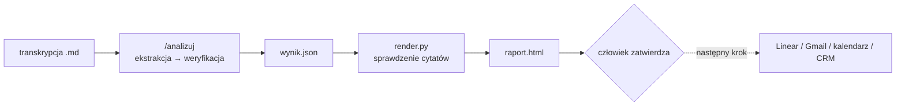

# Analiza rozmów z klientem: prototyp

Zamienia transkrypcję rozmowy z klientem w listę zadań, decyzji, zakazów i ryzyk. Z listy powstaje czytelny raport ze szkicem maila podsumowującego.

## Co robi i dlaczego tak

1. **Ekstrakcja.** Komenda `/analizuj` wypisuje z rozmowy każdą pozycję: typ, właściciela, termin, warunek, status i dosłowny cytat.
2. **Weryfikacja.** Pozycje bez dosłownego cytatu są usuwane. Gdy ktoś zmienił zdanie, zostaje ostatnia wersja. Błąd jest oddzielony od nowej funkcji, a zakazy zapisane osobno. Daty są zestawione ze sobą. To, co nie wynika wprost z cytatu, jest oznaczone jako **wniosek**. Cytaty są po to, żeby każdą pozycję dało się sprawdzić w kilka sekund i żeby model nie dopisywał ustaleń, które nie padły.
3. **Raport.** Stały skrypt `render.py` zamienia `wynik.json` w `raport.html`. Wcześniej porównuje każdy cytat z transkrypcją i odmawia, jeśli któryś nie jest dosłowny. Stały skrypt zamiast HTML pisanego za każdym razem od nowa daje ten sam układ przy każdej rozmowie i twardą kontrolę cytatów.
4. **Człowiek zatwierdza.** Nic nie trafia do klienta automatycznie. Szkic maila i lista zadań to propozycja do przejrzenia.



## Jak uruchomić

1. Otwórz Claude Code w tym folderze (`C:\Users\User\analizy`).
2. Wpisz: `/analizuj ops/transkrypcje/auto-tama/2026-10-06-call-statusowy.md` (albo podaj inny plik `.md`).
3. Wynik pojawi się w `wyniki/<nazwa transkrypcji>/`: `wynik.json` i `raport.html`.

Jeśli komenda `/analizuj` nie pojawi się na liście, wpisz zamiast niej:

```
Wykonaj instrukcje z .claude/commands/analizuj.md na pliku X.md
```

(gdzie `X.md` to plik transkrypcji).

Raport można też przegenerować ręcznie:

```
python -I render.py wyniki/transkrypcja-spotkanie/wynik.json --transkrypcja ops/transkrypcje/auto-tama/2026-10-06-call-statusowy.md
```

## Struktura

| Plik | Rola |
|---|---|
| `.claude/commands/analizuj.md` | instrukcja dla Claude Code (kroki, schemat JSON) |
| `render.py` | walidacja schematu i cytatów, generowanie raportu (sama biblioteka standardowa Pythona) |
| `ops/transkrypcje/auto-tama/2026-10-06-call-statusowy.md` | przykładowa transkrypcja (fikcyjna) |
| `wyniki/` | wyniki analiz, jeden folder na transkrypcję |
| `kontrola.md` | kontrola jakości na przykładowej rozmowie |
| `logi/` | logi z pracy z AI (sesje Claude Code: surowe `.jsonl` i czytelne `.md`) |

## Synchronizacja z Linear

Po przejrzeniu raportu: wyślij pozycje do Linear jednym poleceniem.

```bash
python3 linear_sync.py wyniki/<klient>/<nazwa>/wynik.json --klient <slug>
python3 linear_sync.py wyniki/<klient>/<nazwa>/wynik.json --klient auto-tama --dry-run
```

Wymaga `LINEAR_API_KEY` w `.env`. Klucz musi mieć dostęp do zespołu `RIN`.

- Sprawdza i tworzy brakujące etykiety w zespole.
- Sekcja 1 (zrób teraz) → stan **Todo**; `bug`/`zmiana_konfiguracji`/`poprawka_bazy_wiedzy` + `pewnosc: wysoka` + brak `konflikt_z_zakazem` → etykieta **Dla agenta**.
- Sekcja 2 (czeka na klienta) → **Backlog** + etykieta **Czeka na klienta**.
- Sekcja 3 (backlog produktowy) → **Backlog** + etykieta **Produkt**; jeśli ta sama funkcja pojawia się u ≥ 2 klientów → etykieta **Wielu klientów**.
- Sekcja 4 (zakazy) → zapisuje do `ops/klienci/<klient>/karta.json`, **bez zgłoszenia w Linear**.
- Sekcja 5 (ryzyka) → **Todo** + etykieta **Ryzyko** + priorytet High; przy ≥ 2 wystąpieniach tego samego `temat_ryzyka` → etykieta **Powtarzające się ryzyko** + Urgent.
- **Strażnik zakazów**: pozycja z `konflikt_z_zakazem` → **Backlog** + etykieta **Zablokowane przez zakaz**, bez **Dla agenta**.
- **Pewność niska**: `pewnosc: niska` → etykieta **Do weryfikacji**.
- **Idempotentny (sha256)**: ta sama treść `wynik.json` → pominięcie. Inne źródło dla tej samej `klucz_sprawy` → komentarz w istniejącym zgłoszeniu.
- **Aktualizacje otwartych spraw**: `aktualizacje_spraw` z wynik.json → zmiana stanu istniejącego zgłoszenia w Linear (Todo/Done/Cancelled).
- Po każdym przebiegu regeneruje `ops/klienci/<klient>/karta.md`.

## Pamięć między rozmowami

Kontekst klienta jest przechowywany w `ops/klienci/<klient>/karta.json`:

- **`zakazy`** — lista aktywnych zakazów (id + cytat). Analizuj.md sprawdza każdą pozycję względem tych zakazów i ustawia `konflikt_z_zakazem`.
- **`otwarte_sprawy`** — mapowanie `klucz_sprawy → {linear_id, identifier, url, zrodla[]}`. Używane do idempotentności i aktualizacji statusów.
- **`ryzyka`** — historia wystąpień ryzyk (per temat, per źródło). Przy ≥ 2 unikalnych źródłach → eskalacja.
- **`historia_zakazow`** — uchylone zakazy (zachowane dla audytu).

`ops/produkt/prosby.json` — globalna lista próśb o funkcje produktowe, mapowanie `klucz_funkcji → [{klient, cytat, zrodlo}]`. Przy ≥ 2 klientach → etykieta **Wielu klientów**.

`ops/.przetworzone.json` — rejestr sha256 przetworzonych `wynik.json`. Zapobiega podwójnemu wysyłaniu.

## Struktura ops/

```
ops/
  transkrypcje/<klient>/        – transkrypcje rozmów
  klienci/<klient>/
    karta.json                  – zakazy, decydenci, otwarte sprawy, historia ryzyk
    karta.md                    – czytelna wersja karty (generowana przez linear_sync.py)
  produkt/
    prosby.json                 – globalna lista próśb o funkcje (aktualizowana przez linear_sync.py)
  .przetworzone.json            – rejestr sha256 przetworzonych wynik.json
```

## Założenia

- Silnikiem jest Claude Code na subskrypcji, bez klucza API.
- Integracje z narzędziami (Linear, Gmail, kalendarz, CRM) są opisane jako następny krok, ale nie zbudowane.
- Nic nie wychodzi do klienta bez zatwierdzenia przez człowieka.
- Analiza zakłada perspektywę dostawcy („nasz zespół”). Nazwy firm i osób pochodzą wyłącznie z transkrypcji.

## Kontrola jakości

Na przykładowej rozmowie (szczegóły w [kontrola.md](kontrola.md)):

| Wynik | Folder | Kontrola |
|---|---|---|
| pierwszy | `wyniki/transkrypcja-spotkanie/` | **19 / 20** |
| od zera | `wyniki/od-zera/` | **20 / 20** |

Pierwszy wynik (`wyniki/transkrypcja-spotkanie/`) był poprawiany w trakcie budowy narzędzia, więc nie pokazuje, co daje samo uruchomienie komendy. Miarodajny jest wynik od zera (`wyniki/od-zera/`), wygenerowany jednym przebiegiem komendy i niepoprawiany ręcznie. Zastrzeżenie: przebieg od zera zrobiono w sesji, która znała już listę kontrolną z `kontrola.md`. W pełni niezależny wynik da dopiero przebieg w nowej sesji.

Znane ograniczenia:
- W pierwszym wyniku okno testu wstępu podano tylko jako 12–16.10, bez drugiej możliwości od 26.10 (po urlopie). Wynik od zera ma oba okna.
- Godzin Torunia w dni robocze nie ma w rozmowie, więc oznaczono je jako wniosek, a nie fakt.
- Kompletność listy sprawdzana jest ręcznie. Automatycznie sprawdzana jest tylko dosłowność cytatów.
- Daty względne („do czwartku”, „wczoraj”) są przeliczane od daty spotkania. Przeliczone daty przypomnień są oznaczone jako wnioski.

## Co dalej z większą ilością czasu

- **Automatyczna kontrola kompletności:** zestaw rozmów testowych z listą oczekiwanych pozycji, uruchamiany po każdej zmianie komendy.
- **Integracje po zatwierdzeniu:** zadania do Linear, szkic maila do Gmaila (jako szkic, nie wysyłka), spotkania do kalendarza, notatka do CRM.
- **Zatwierdzanie w raporcie:** przy każdej pozycji akceptuj, popraw albo odrzuć, a dopiero potem eksport.
- **Historia klienta:** zakazy i ustalenia z poprzednich rozmów jako kontekst do następnej analizy, z wykrywaniem sprzeczności.
- **Kalendarz w kodzie:** konflikty dat liczone przez skrypt, a nie przez model, żeby nie gubić okien takich jak „od 26.10”.

## Logi

Logi z pracy z AI są w folderze [logi/](logi/): surowe sesje Claude Code (`.jsonl`) i ich czytelne wersje (`.md`, tylko wiadomości użytkownika i odpowiedzi asystenta).
