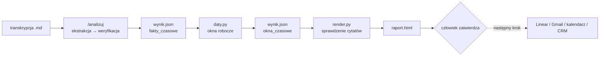
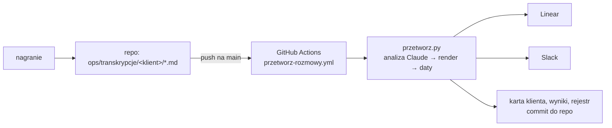

# Analiza rozmów z klientem: prototyp

Zamienia transkrypcję rozmowy z klientem w listę zadań, decyzji, zakazów i ryzyk. Z listy powstaje czytelny raport ze szkicem maila podsumowującego.

## Co robi i dlaczego tak

1. **Ekstrakcja.** Komenda `/analizuj` wypisuje z rozmowy każdą pozycję: typ, właściciela, termin, warunek, status i dosłowny cytat.
2. **Weryfikacja.** Pozycje bez dosłownego cytatu są usuwane. Gdy ktoś zmienił zdanie, zostaje ostatnia wersja. Błąd jest oddzielony od nowej funkcji, a zakazy zapisane osobno. Daty są zestawione ze sobą. To, co nie wynika wprost z cytatu, jest oznaczone jako **wniosek**. Cytaty są po to, żeby każdą pozycję dało się sprawdzić w kilka sekund i żeby model nie dopisywał ustaleń, które nie padły.
3. **Daty liczy kod.** Model wypisuje surowe fakty czasowe (`fakty_czasowe`): urlopy, blokady, terminy i najwcześniejsze starty z dosłownymi cytatami. Skrypt `daty.py` oblicza z nich wolne okna robocze (Pn–Pt) dla każdej sprawy, stosując blokady specyficzne i globalne (np. urlop = blokada dla wszystkich). Wynik trafia do `okna_czasowe` w `wynik.json`. Model nie liczy konfliktów sam — zamiast tego dostarcza dane, kod robi arytmetykę.
4. **Raport.** Stały skrypt `render.py` zamienia `wynik.json` w `raport.html`. Wcześniej porównuje każdy cytat — w pozycjach, aktualizacjach i `fakty_czasowe` — z transkrypcją i odmawia, jeśli któryś nie jest dosłowny. Stały skrypt zamiast HTML pisanego za każdym razem od nowa daje ten sam układ przy każdej rozmowie i twardą kontrolę cytatów.
5. **Człowiek zatwierdza.** Nic nie trafia do klienta automatycznie. Szkic maila i lista zadań to propozycja do przejrzenia.



## Jak uruchomić

### Jeden przebieg end-to-end (zalecane)

```bash
python3 przetworz.py ops/transkrypcje/<klient>/<plik>.md
```

Skrypt: sprawdza rejestr (pomija, jeśli już przetworzona), uruchamia analizę Claude, render.py, daty.py, linear_sync.py, wysyła Slack i rejestruje. Wymaga `LINEAR_API_KEY` i `SLACK_WEBHOOK_URL` w `.env`.

```bash
python3 przetworz.py ops/transkrypcje/auto-tama/2026-10-06-call-statusowy.md --wymus  # wymuś ponowne przetworzenie
```

### Krok po kroku (ręcznie)

1. Otwórz Claude Code w tym folderze.
2. Wpisz: `/analizuj ops/transkrypcje/auto-tama/2026-10-06-call-statusowy.md` (albo podaj inny plik `.md`).
3. Po zapisaniu `wynik.json` uruchom daty.py i render.py:

```bash
python -I daty.py wyniki/auto-tama/2026-10-06-call-statusowy/wynik.json
python -I render.py wyniki/auto-tama/2026-10-06-call-statusowy/wynik.json --transkrypcja ops/transkrypcje/auto-tama/2026-10-06-call-statusowy.md
```

Jeśli komenda `/analizuj` nie pojawi się na liście, wpisz zamiast niej:

```
Wykonaj instrukcje z .claude/commands/analizuj.md na pliku X.md
```

## Struktura

| Plik | Rola |
|---|---|
| `.claude/commands/analizuj.md` | instrukcja dla Claude Code (kroki, schemat JSON, zapis w częściach) |
| `render.py` | walidacja schematu i cytatów (w tym fakty_czasowe), generowanie raportu |
| `daty.py` | oblicza wolne okna robocze z fakty_czasowe, zapisuje okna_czasowe do wynik.json |
| `przetworz.py` | automat end-to-end: rejestr → Claude → daty.py → render.py → Linear → Slack |
| `linear_sync.py` | wysyła wynik.json do Linear (team RIN); idempotentny po klucz_sprawy |
| `sekrety.py` | czyszczenie kluczy API z białych i niewidocznych znaków (Notatki na Macu je dodają) |
| `ops/transkrypcje/auto-tama/2026-10-06-call-statusowy.md` | przykładowa transkrypcja (fikcyjna) |
| `wyniki/` | wyniki analiz, jeden folder na transkrypcję |
| `testy/test_logika.py` | testy jednostkowe logiki (bez sieci, 40 testów) |
| `testy/uruchom.py` | runner testów oczekiwań (X/Y, exit 0/1) |
| `testy/oczekiwania/` | pliki oczekiwań zakotwiczone w cytatach |
| `kontrola.md` | kontrola jakości na przykładowej rozmowie |
| `logi/przebiegi/` | logi automatycznych przebiegów przetworz.py |
| `logi/` | logi z pracy z AI (sesje Claude Code: surowe `.jsonl` i czytelne `.md`) |

## Automat przetwarzania (`przetworz.py`)

`przetworz.py` uruchamia pełen pipeline bez interakcji:

```
transkrypcja.md
  → sha256 check (rejestr)
  → claude --print (analizuj.md) → wynik.json
  → render.py (sprawdzenie cytatów) → raport.html
  → daty.py (okna robocze) → wynik.json [okna_czasowe]
  → linear_sync.py → Linear
  → Slack (podsumowanie z linkami)
  → rejestr (hash transkrypcji)
```

Wymagane zmienne w `.env`:
- `LINEAR_API_KEY` — klucz API Linear (team RIN)
- `SLACK_WEBHOOK_URL` — webhook do kanału powiadomień

Zabezpieczenia: lock file (jeden przebieg jednocześnie), rejestr rejestruje dopiero po pełnym sukcesie (retry jest bezpieczny), klucze nigdy nie trafiają do logów.

Log trafia do `logi/przebiegi/<timestamp>-<klient>.log`.

`--bez-analizy` pomija model i przetwarza istniejący `wynik.json` (render, daty, Linear, testy, Slack): do naprawy stanu po poprawce kodu, bez ponownego wołania Claude'a.

Klucze z `.env` i ze zmiennych środowiskowych są czyszczone z białych i niewidocznych znaków (`sekrety.py`). Klucz wklejony z Notatek potrafi mieć na końcu enter albo `\u2028` i wygląda poprawnie, a serwer go odrzuca. W logu pojawia się tylko ostrzeżenie z nazwą zmiennej i liczbą usuniętych znaków, nigdy wartość.

### Wiadomość na Slacku

Zawsze zawiera osobne linie (także z zerem): **Zamknięte**, **Wznowione**, **Zablokowane przez zakaz**, **Powtarzające się ryzyka**, **Wielu klientów** i **Do weryfikacji**, każda z tytułami pozycji. Do tego model analizy i wynik testów oczekiwań.

## Daty liczy kod (`daty.py`)

```bash
python3 -I daty.py wyniki/<klient>/<nazwa>/wynik.json
```

Czyta pole `fakty_czasowe` (ekstrahowane przez model z transkrypcji), oblicza wolne okna robocze Pn–Pt dla każdej sprawy i zapisuje wynik w `okna_czasowe`. Typy faktów:

| Typ | Znaczenie |
|---|---|
| `urlop` / `blokada` | Okres, w którym nie można pracować nad zadaniem |
| `termin` | Ostateczny termin dla danej sprawy |
| `start_nie_wczesniej` | Najwcześniejsza data startu |

`dotyczy: "wszystko_nowe"` = blokada globalna (np. urlop = blokuje wszystkie nowe wdrożenia).

## Synchronizacja z Linear

Po przejrzeniu raportu: wyślij pozycje do Linear jednym poleceniem.

```bash
python3 linear_sync.py wyniki/<klient>/<nazwa>/wynik.json --klient <slug>
python3 linear_sync.py wyniki/<klient>/<nazwa>/wynik.json --klient auto-tama --dry-run
```

Wymaga `LINEAR_API_KEY` w `.env`. Klucz musi mieć dostęp do zespołu `RIN`.

- Sprawdza i tworzy brakujące etykiety w zespole.
- Sekcja 1 (zrób teraz) → stan **Todo**; `bug`/`zmiana_konfiguracji`/`poprawka_bazy_wiedzy` + `pewnosc: wysoka` + brak `konflikt_z_zakazem` → etykieta **Dla agenta**.
- Sekcja 2 (czeka na klienta) → **Backlog** + etykieta **Czeka na klienta**.
- Sekcja 3 (backlog produktowy) → **Backlog** + etykieta **Produkt**; jeśli ta sama funkcja pojawia się u ≥ 2 klientów → etykieta **Wielu klientów**.
- Sekcja 4 (zakazy) → zapisuje do `ops/klienci/<klient>/karta.json`, **bez zgłoszenia w Linear**.
- Sekcja 5 (ryzyka) → **Todo** + etykieta **Ryzyko** + priorytet High; przy ≥ 2 wystąpieniach tego samego `temat_ryzyka` → etykieta **Powtarzające się ryzyko** + Urgent.
- **Strażnik zakazów**: pozycja z `konflikt_z_zakazem` → **Backlog** + etykieta **Zablokowane przez zakaz**, bez **Dla agenta**.
- **Pewność niska**: `pewnosc: niska` → etykieta **Do weryfikacji**.
- **Idempotentny po klucz_sprawy**: ta sama `klucz_sprawy` z innego źródła → komentarz w istniejącym zgłoszeniu. Ochrona przed duplikatami opiera się na kluczu sprawy, nie na sha256 pliku.
- **Aktualizacje otwartych spraw**: `aktualizacje_spraw` z wynik.json → zmiana stanu istniejącego zgłoszenia w Linear (Todo/Done/Cancelled). Aktualizacja musi pochodzić z rozmowy późniejszej niż ta, z której sprawa pochodzi; ta sama aktualizacja nie zadziała dwa razy, a zgłoszenie, które już jest w docelowym stanie, nie dostaje drugiego komentarza.
- **Sprawa wspomniana ponownie** (ta sama `klucz_sprawy`): komentarz z nowym cytatem, **nowy termin** z najnowszej rozmowy oraz — dla ryzyk — licznik rozmów w karcie i eskalacja (**Powtarzające się ryzyko** + Urgent) także dla zgłoszenia, które już istnieje.
- **Zakazy** dostają unikalne id w karcie (numeracja z rozmowy zaczyna się od Z1, więc przy kolizji linear_sync nadaje kolejny wolny numer), a nie są pomijane.
- Po każdym przebiegu regeneruje `ops/klienci/<klient>/karta.md`.

## Pamięć między rozmowami

Kontekst klienta jest przechowywany w `ops/klienci/<klient>/karta.json`:

- **`zakazy`** — lista aktywnych zakazów (id + cytat). Analizuj.md sprawdza każdą pozycję względem tych zakazów i ustawia `konflikt_z_zakazem`.
- **`otwarte_sprawy`** — mapowanie `klucz_sprawy → {linear_id, identifier, url, zrodla[]}`. Używane do idempotentności i aktualizacji statusów.
- **`ryzyka`** — historia wystąpień ryzyk (per temat, per źródło). Przy ≥ 2 unikalnych źródłach → eskalacja.
- **`historia_zakazow`** — uchylone zakazy (zachowane dla audytu).

`ops/produkt/prosby.json` — globalna lista próśb o funkcje produktowe, mapowanie `klucz_funkcji → [{klient, cytat, zrodlo}]`. Przy ≥ 2 klientach → etykieta **Wielu klientów**.

`ops/.przetworzone.json` — rejestr sha256 **transkrypcji** (nie wynik.json). `przetworz.py` pomija transkrypcje, których hash jest już w rejestrze; rejestruje dopiero po pełnym sukcesie (Linear + Slack). Flaga `--wymus` pomija sprawdzenie.

## Struktura ops/

```
ops/
  transkrypcje/<klient>/        – transkrypcje rozmów
  klienci/<klient>/
    karta.json                  – zakazy, decydenci, otwarte sprawy, historia ryzyk
    karta.md                    – czytelna wersja karty (generowana przez linear_sync.py)
  produkt/
    prosby.json                 – globalna lista próśb o funkcje (aktualizowana przez linear_sync.py)
  .przetworzone.json            – rejestr sha256 transkrypcji (zarządza przetworz.py)
  .przetworz.lock               – lock file (jeden przebieg jednocześnie)
```

## Założenia

- Silnikiem jest Claude Code na subskrypcji, bez klucza API.
- Integracje z narzędziami (Linear, Gmail, kalendarz, CRM) są opisane jako następny krok, ale nie zbudowane.
- Nic nie wychodzi do klienta bez zatwierdzenia przez człowieka.
- Analiza zakłada perspektywę dostawcy („nasz zespół”). Nazwy firm i osób pochodzą wyłącznie z transkrypcji.

## Automatyczny start

Nagranie trafia do repo jako transkrypcja, a GitHub Actions sam uruchamia `przetworz.py` w chmurze.



- **Wyzwalacz:** push na `main` zmieniający `ops/transkrypcje/**/*.md` albo ręcznie (*Actions → Przetwarzanie rozmów → Run workflow*, opcjonalnie ze ścieżką transkrypcji).
- **Wykrywanie:** workflow bierze pliki dodane lub zmienione w pushu. Przy pierwszym pushu albo braku poprzedniego commita bierze wszystkie transkrypcje, a już przetworzone pomija rejestr sha256.
- **Jedna rozmowa naraz:** `concurrency` bez anulowania trwających przebiegów. Każdy przebieg startuje od najnowszego `main`, więc widzi karty klientów zaktualizowane przez poprzedni.
- **Zapis wyników:** po każdej transkrypcji commit `[automat] przetworzono <plik> [skip ci]` (`wyniki/`, `ops/klienci/`, `ops/produkt/`, `ops/.przetworzone.json`, `logi/przebiegi/`). `[skip ci]` i push tokenem `GITHUB_TOKEN` nie uruchamiają workflow drugi raz. Przy odrzuconym pushu: `pull --rebase` i ponowna próba.
- **Błędy:** gdy `przetworz.py` się wysypie, wysyła alert na Slacka, a workflow kończy się błędem.
- **Model:** zmienna `RINVO_MODEL` (w GitHubie: *Settings → Variables*), domyślnie `claude-sonnet-5-5`. Model jest podany w wiadomości na Slacku.

Sekrety (*Settings → Secrets and variables → Actions*): `CLAUDE_CODE_OAUTH_TOKEN` (z `claude setup-token`), `LINEAR_API_KEY`, `SLACK_WEBHOOK_URL`. Bez pliku `.env` `przetworz.py` czyta je ze zmiennych środowiskowych.

## Testy automatyczne

Dwa poziomy testów uruchamiane bez sieci i bez modelu AI:

### Testy jednostkowe logiki

```bash
python3 testy/test_logika.py
```

Pokrycie (40 testów):
- `should_get_agent_label` — etykieta „Dla agenta” tylko dla bug/konfiguracja/baza_wiedzy z wysoka pewnością, bez zakazu, bez nowej_funkcji.
- `process_aktualizacje` — ta sama rozmowa odrzucona, ta sama data odrzucona, późniejsza data akceptowana, nieznana sprawa pominięta.
- `daty.py compute_windows` — blokada globalna, weekendy pomijane, deadline ogranicza okno.
- `daty.py has_temporal_word` — frazy przyszłe wykrywane, neutralne cytaty nie.
- `update_risk_counter` — dwa różne źródła eskalują, to samo źródło dwa razy nie.
- Rejestr sha256 — ten sam hash wykryty, różne treści dają różne hashe.
- Strażnik aktualizacji liczy się od **pochodzenia** sprawy (pierwsze źródło), a komentarz z późniejszej rozmowy go nie blokuje; aktualizacja z tej samej rozmowy nie zadziała dwa razy.
- Zakazy — id są unikalne w karcie (numeracja Z1, Z2… zaczyna się od nowa w każdej rozmowie), ponowna analiza nie dubluje zakazów.
- Czyszczenie kluczy (`sekrety.py`) — spacje, entery, `\u2028`, `\u2029`, `\u00a0`, znaki zerowej szerokości.
- Wiadomość Slack — stałe linie (także `: 0`) i parsowanie zdarzeń z `linear_sync.py`.

### Testy oczekiwań (po analizie)

```bash
python3 testy/uruchom.py wyniki/<klient>/<nazwa>/wynik.json testy/oczekiwania/<klient>-<nazwa>.json
```

```bash
python3 testy/uruchom.py wyniki/<klient>/<nazwa>/wynik.json testy/oczekiwania/<klient>-<nazwa>.json --online
```

Każde oczekiwanie jest zakotwiczone w cytacie (`fragment_cytatu`, krótki i dosłowny) albo w kluczu sprawy. Rodzaje testów (`typ_sprawdzania`):

| Rodzaj | Co sprawdza |
|---|---|
| `pozycje` (domyślny) | pozycja znaleziona po cytacie: sekcja, status, rodzaj, termin, przypomnienia, etykiety, okna czasowe |
| `aktualizacja` | wpis w `aktualizacje_spraw` (zamknięta / wznowiona) albo jego brak |
| `karta_sprawa`, `karta_zakaz`, `karta_ryzyka` | stan **po rozmowie** w karcie klienta: sprawa zamknięta/otwarta, aktywny zakaz, licznik ryzyk |
| `prosby` | ta sama funkcja u kilku klientów w `ops/produkt/prosby.json` |
| `okno_w`, `okna_dokladnie` | okna czasowe sprawy |
| `mail_nie_zawiera` | szkic maila nie obiecuje tego, czego klient zabronił |
| `linear` | stan, etykiety, priorytet i termin zgłoszenia w Linearze (**tylko z `--online`**) |

Bez `--online` testy `linear` są pomijane i liczone osobno, a reszta działa offline. Wyjście: `PASS X/Y` lub `FAIL X/Y` (kod 0 tylko gdy wszystkie wykonane przeszły).

Pliki oczekiwań:
- `testy/oczekiwania/auto-tama-2026-10-06-call-statusowy.json` — 20 testów
- `testy/oczekiwania/klinika-usmiech-2026-10-13-call-statusowy.json` — 10 testów
- `testy/oczekiwania/auto-tama-2026-10-13-call-statusowy.json` — 38 testów (w tym stan po rozmowie w karcie, `prosby.json` i Linearze)

`przetworz.py` uruchamia plik oczekiwań automatycznie po analizie (gdy plik istnieje) i dodaje wynik do wiadomości Slack.

### Kontrola jakości ręczna

Na przykładowej rozmowie (szczegóły w [kontrola.md](kontrola.md)):

| Wynik | Folder | Kontrola |
|---|---|---|
| pierwszy | `wyniki/transkrypcja-spotkanie/` | **19 / 20** |
| od zera | `wyniki/od-zera/` | **20 / 20** |

Pierwszy wynik (`wyniki/transkrypcja-spotkanie/`) był poprawiany w trakcie budowy narzędzia, więc nie pokazuje, co daje samo uruchomienie komendy. Miarodajny jest wynik od zera (`wyniki/od-zera/`), wygenerowany jednym przebiegiem komendy i niepoprawiany ręcznie. Zastrzeżenie: przebieg od zera zrobiono w sesji, która znała już listę kontrolną z `kontrola.md`. W pełni niezależny wynik da dopiero przebieg w nowej sesji.

Znane ograniczenia:
- W pierwszym wyniku okno testu wstępu podano tylko jako 12–16.10, bez drugiej możliwości od 26.10 (po urlopie). Wynik od zera ma oba okna.
- Godzin Torunia w dni robocze nie ma w rozmowie, więc oznaczono je jako wniosek, a nie fakt.
- Kompletność listy sprawdzana jest ręcznie (oczekiwania) i automatycznie (uruchom.py). Dosłowność cytatów sprawdza render.py.
- Daty względne („do czwartku”, „wczoraj”) są przeliczane od daty spotkania. Przeliczone daty przypomnień są oznaczone jako wnioski.

## Co dalej z większą ilością czasu

- **Integracje po zatwierdzeniu:** zadania do Linear, szkic maila do Gmaila (jako szkic, nie wysyłka), spotkania do kalendarza, notatka do CRM.
- **Zatwierdzanie w raporcie:** przy każdej pozycji akceptuj, popraw albo odrzuć, a dopiero potem eksport.
- **Historia klienta:** zakazy i ustalenia z poprzednich rozmów jako kontekst do następnej analizy, z wykrywaniem sprzeczności.
- ~~**Kalendarz w kodzie:**~~ Zrealizowane w `daty.py` — model dostarcza `fakty_czasowe`, kod oblicza wolne okna robocze.
- ~~**Automatyczna kontrola kompletności:**~~ Zrealizowane w `testy/` — oczekiwania zakotwiczone w cytatach, runner X/Y, integracja z przetworz.py.

## Logi

Logi z pracy z AI są w folderze [logi/](logi/): surowe sesje Claude Code (`.jsonl`) i ich czytelne wersje (`.md`, tylko wiadomości użytkownika i odpowiedzi asystenta).
