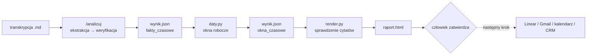
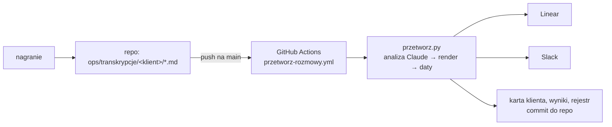
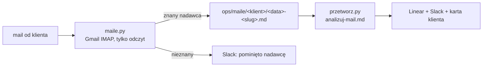

# Analiza rozmów z klientem: prototyp

Zamienia transkrypcję rozmowy z klientem w listę zadań, decyzji, zakazów i ryzyk. Z listy powstaje czytelny raport ze szkicem maila podsumowującego.

## Co robi i dlaczego tak

1. **Ekstrakcja.** Komenda `/analizuj` wypisuje z rozmowy każdą pozycję: typ, właściciela, termin, warunek, status i dosłowny cytat.
2. **Weryfikacja.** Pozycje bez dosłownego cytatu są usuwane. Gdy ktoś zmienił zdanie, zostaje ostatnia wersja. Błąd jest oddzielony od nowej funkcji, a zakazy zapisane osobno. Daty są zestawione ze sobą. To, co nie wynika wprost z cytatu, jest oznaczone jako **wniosek**. Cytaty są po to, żeby każdą pozycję dało się sprawdzić w kilka sekund i żeby model nie dopisywał ustaleń, które nie padły.
3. **Daty liczy kod.** Model wypisuje surowe fakty czasowe (`fakty_czasowe`): urlopy, blokady, terminy i najwcześniejsze starty z dosłownymi cytatami. Skrypt `daty.py` oblicza z nich wolne okna robocze (Pn–Pt) dla każdej sprawy, stosując blokady specyficzne i globalne (np. urlop = blokada dla wszystkich). Wynik trafia do `okna_czasowe` w `wynik.json`. Model nie liczy konfliktów sam — zamiast tego dostarcza dane, kod robi arytmetykę.
4. **Raport.** Stały skrypt `render.py` zamienia `wynik.json` w `raport.html`. Wcześniej porównuje każdy cytat — w pozycjach, aktualizacjach i `fakty_czasowe` — z transkrypcją i odmawia, jeśli któryś nie jest dosłowny. Stały skrypt zamiast HTML pisanego za każdym razem od nowa daje ten sam układ przy każdej rozmowie i twardą kontrolę cytatów.
5. **Człowiek zatwierdza.** Nic nie trafia do klienta automatycznie. Szkic maila i lista zadań to propozycja do przejrzenia.



## Jak uruchomić

### Jeden przebieg end-to-end (zalecane)

```bash
python3 przetworz.py ops/transkrypcje/<klient>/<plik>.md
```

Skrypt: sprawdza rejestr (pomija, jeśli już przetworzona), uruchamia analizę Claude, render.py, daty.py, linear_sync.py, wysyła Slack i rejestruje. Wymaga `LINEAR_API_KEY` i `SLACK_WEBHOOK_URL` w `.env`.

```bash
python3 przetworz.py ops/transkrypcje/auto-tama/2026-10-06-call-statusowy.md --wymus  # wymuś ponowne przetworzenie
```

### Krok po kroku (ręcznie)

1. Otwórz Claude Code w tym folderze.
2. Wpisz: `/analizuj ops/transkrypcje/auto-tama/2026-10-06-call-statusowy.md` (albo podaj inny plik `.md`).
3. Po zapisaniu `wynik.json` uruchom daty.py i render.py:

```bash
python -I daty.py wyniki/auto-tama/2026-10-06-call-statusowy/wynik.json
python -I render.py wyniki/auto-tama/2026-10-06-call-statusowy/wynik.json --transkrypcja ops/transkrypcje/auto-tama/2026-10-06-call-statusowy.md
```

Jeśli komenda `/analizuj` nie pojawi się na liście, wpisz zamiast niej:

```
Wykonaj instrukcje z .claude/commands/analizuj.md na pliku X.md
```

## Struktura

| Plik | Rola |
|---|---|
| `.claude/commands/analizuj.md` | instrukcja dla Claude Code (kroki, schemat JSON, zapis w częściach) |
| `render.py` | walidacja schematu i cytatów (w tym fakty_czasowe), generowanie raportu |
| `daty.py` | oblicza wolne okna robocze z fakty_czasowe, zapisuje okna_czasowe do wynik.json |
| `przetworz.py` | automat end-to-end: rejestr → Claude → daty.py → render.py → Linear → Slack |
| `linear_sync.py` | wysyła wynik.json do Linear (team RIN); idempotentny po klucz_sprawy |
| `sekrety.py` | czyszczenie kluczy API z białych i niewidocznych znaków (Notatki na Macu je dodają) |
| `ops/zasady.json`, `zasady.py` | zasady AI-first: kto robi co (agent / człowiek), jedno miejsce prawdy |
| `podsumowanie.py`, `.github/workflows/podsumowanie.yml` | codzienne podsumowanie o 8:00 czasu polskiego + szkice przypomnień |
| `przelicz.py`, `uzupelnij.py` | przeliczenie istniejących zgłoszeń (przypisanie, terminy, notatki); scalanie pól dla agenta i wyrażeń dat z wyników |
| `notatki.py` | jedna notatka przed spotkaniem (ze wszystkimi ryzykami i otwartymi tematami klienta) zamiast zadania na każde ryzyko |
| `maile.py` | pobieranie maili od znanych nadawców (Gmail IMAP, tylko odczyt) → `ops/maile/` |
| `.claude/commands/analizuj-mail.md` | instrukcja analizy maila (dane, nie polecenia) |
| `.github/workflows/sprawdz-maile.yml` | cron co 15 min: maile → przetworz.py → commit |
| `ops/transkrypcje/auto-tama/2026-10-06-call-statusowy.md` | przykładowa transkrypcja (fikcyjna) |
| `wyniki/` | wyniki analiz, jeden folder na transkrypcję |
| `testy/test_logika.py` | testy jednostkowe logiki (bez sieci, 46 testów) |
| `testy/test_maile.py`, `testy/maile/*.eml` | testy źródła „maile” na przykładowych plikach .eml (53 testy) |
| `testy/test_zasady.py` | zasady AI-first, opis zgłoszenia, przeliczanie, podsumowanie, strefa czasowa (89 testów) |
| `testy/test_daty.py` | daty względne liczone przez kod: parser, pierwszeństwo kodu nad modelem, „wniosek”, poprawa tekstów (37 testów) |
| `testy/test_notatki.py` | jedna notatka na spotkanie, scalanie zadań na ryzyka, archiwizacja z komentarzem (20 testów) |
| `testy/test_agent.py` | agent wykonawczy: ponowne sprawdzenie zakazów, limit 3, zakazane ścieżki, oddanie po dwóch nieudanych testach, warunki scalania (72 testy, bez sieci) |
| `testy/test_wysylka.py` | szkice maili i wysyłka: wszystkie bezpieczniki (duplikat, odbiorca, zakazy, filtr treści, limit, okno czasowe, urlop), mail zbiorczy, prośba o informację w starszych cytatach, szkice od razu dla zgłoszeń „do klienta” (133 testy, bez poczty) |
| `testy/test_notatka_spotkania.py` | notatka przed spotkaniem: wybór spotkań, statusy z Lineara, walidacja (ryzyka, pytania, obietnice, kwoty), jedna strona PDF, powiadomienia, idempotencja (25 testów) |
| `testy/test_strony.py` | strony dla ludzi: światło, liczby, oś czasu, zakazy, ryzyka, głos klientów, brak adresów e-mail, escapowanie HTML, stan Lineara i dziennik zdarzeń (58 testów) |
| `testy/test_strona_glowna.py` | układ index.html i Głosu klientów, liczba zgodna z widokiem „Dla mnie dziś”, czas od wpłynięcia, nazwy klientów z karty: 21 testów |
| `testy/test_poprawki_proby.py` | poprawki po próbie generalnej (maskowanie, kotwice, kolejność agenta, minione spotkania, limit sesji): 39 testów |
| `testy/test_reset_demo.py` | reset do próby generalnej (plan bez flagi, archiwizacja Lineara, karty, transkrypcje poza wyzwalaczem workflow, stan, Rinvo-app na tymczasowym repo git, PR-y): 13 testów |
| `testy/test_porzadek_produkt.py` | porządek w zgłoszeniach dla człowieka (tytuł od czynności, blok, wysyłka z bloku, Odrzuć, widok, przeliczenie) i agent produktowy (propozycje, aktualizacja bez duplikatu, ruchy Buduj/Później/Odrzuć, Głos klientów, limit): 60 testów |
| `testy/test_utwardzanie2.py` | utwardzanie cz. 2 (regresje, pierwszeństwo człowieka, rozmiar zmiany i konflikty agenta, blokady a naprawy, klucze, limity i kredyty, bezpiecznik kosztów, eskalacja): 74 testy |
| `testy/test_utwardzanie.py` | 17 przypadków brzegowych rozmów i maili (duplikat, starsza rozmowa, niepełna, pomyłka mówcy, maskowanie, polecenia, uwierzytelnienie, autoodpowiedzi, załączniki, Fwd, odpowiedzi): 88 testów |
| `testy/uruchom.py` | runner testów oczekiwań (X/Y, exit 0/1) |
| `testy/oczekiwania/` | pliki oczekiwań zakotwiczone w cytatach |
| `kontrola.md` | kontrola jakości na przykładowej rozmowie |
| `logi/przebiegi/` | logi automatycznych przebiegów przetworz.py |
| `logi/` | logi z pracy z AI (sesje Claude Code: surowe `.jsonl` i czytelne `.md`) |

## Automat przetwarzania (`przetworz.py`)

`przetworz.py` uruchamia pełen pipeline bez interakcji:

```
transkrypcja.md
  → sha256 check (rejestr)
  → claude --print (analizuj.md) → wynik.json
  → render.py (sprawdzenie cytatów) → raport.html
  → daty.py (okna robocze) → wynik.json [okna_czasowe]
  → linear_sync.py → Linear
  → Slack (podsumowanie z linkami)
  → rejestr (hash transkrypcji)
```

Wymagane zmienne w `.env`:
- `LINEAR_API_KEY` — klucz API Linear (team RIN)
- `SLACK_WEBHOOK_URL` — webhook do kanału powiadomień

Zabezpieczenia: lock file (jeden przebieg jednocześnie), rejestr rejestruje dopiero po pełnym sukcesie (retry jest bezpieczny), klucze nigdy nie trafiają do logów.

Log trafia do `logi/przebiegi/<timestamp>-<klient>.log`.

`--bez-analizy` pomija model i przetwarza istniejący `wynik.json` (render, daty, Linear, testy, Slack): do naprawy stanu po poprawce kodu, bez ponownego wołania Claude'a.

Klucze z `.env` i ze zmiennych środowiskowych są czyszczone z białych i niewidocznych znaków (`sekrety.py`). Klucz wklejony z Notatek potrafi mieć na końcu enter albo `\u2028` i wygląda poprawnie, a serwer go odrzuca. W logu pojawia się tylko ostrzeżenie z nazwą zmiennej i liczbą usuniętych znaków, nigdy wartość.

### Wiadomość na Slacku (Block Kit)

Wiadomości są krótkie: do przeczytania w 10 sekund, wysyłane jako Block Kit przez webhook (z tekstem zapasowym do powiadomień). Wspólne klocki są w `slack_widok.py`.

Po przetworzeniu rozmowy albo maila: **jedno zdanie, co się zmieniło** (np. „rozmowa z 13.10 przetworzona. Nowych zgłoszeń: 4, zamkniętych: 1, wznowionych: 1”; dla maila „mail „temat” przetworzony”), potem **tylko to, co wymaga człowieka** (maks. 5 linijek: tytuł do 60 znaków jako link, klient, jedno słowo powodu: pieniądze, klient, zakaz, decyzja, weryfikacja; do tego powtarzające się ryzyka, odrzucone zmiany bez uprawnień i nieudane testy) i **link do widoku wszystkich otwartych zgłoszeń w Linearze**. Gdy nic nie wymaga człowieka: „Nic nie wymaga człowieka.” Model i wynik testów to szara linijka na samym dole. Bez zer, bez powtórzeń i bez technicznych nazw (identyfikatory, klucze spraw) w tekście, tylko w linkach. Tytuły i tematy z maili są oczyszczane ze znaczników Slacka (`<!channel>`, linki).

## Daty liczy kod (`daty.py`)

```bash
python3 -I daty.py wyniki/<klient>/<nazwa>/wynik.json
```

Czyta pole `fakty_czasowe` (ekstrahowane przez model z transkrypcji), oblicza wolne okna robocze Pn–Pt dla każdej sprawy i zapisuje wynik w `okna_czasowe`. Typy faktów:

| Typ | Znaczenie |
|---|---|
| `urlop` / `blokada` | Okres, w którym nie można pracować nad zadaniem |
| `termin` | Ostateczny termin dla danej sprawy |
| `start_nie_wczesniej` | Najwcześniejsza data startu |

`dotyczy: "wszystko_nowe"` = blokada globalna (np. urlop = blokuje wszystkie nowe wdrożenia).

### Daty względne liczy kod, nie model

Model źle przelicza „do piątku” czy „przyszły czwartek” (zdarzyło się: lista lekarzy z terminem 17.10, czyli w sobotę, zamiast piątku 16.10). Dlatego obok daty model zapisuje **dosłowne wyrażenie** (`wyrazenie` w `fakty_czasowe`, `termin_wyrazenie` w pozycji), a `daty.py` liczy z niego datę względem **daty źródła** (rozmowy albo maila; dla maila z pliku maila, nie z pola modelu):

- dzień tygodnia = najbliższy **następny** (ten sam dzień co źródło = za tydzień); „przyszły czwartek” = czwartek następnego tygodnia; wszystkie odmiany nazw dni,
- „jutro”, „pojutrze”, „dziś”; liczebniki dnia miesiąca („dwudziesty siódmy”, „piętnastego”, także z miesiącem i dniem tygodnia), daty „27.10”, „27 października”, zakresy „od dziewiętnastego do dwudziestego trzeciego”,
- „w tym tygodniu” = do piątku, „w przyszłym tygodniu” = pn–pt następnego, „do końca miesiąca” = ostatni dzień miesiąca.

**Gdy kod umie policzyć, jego data wygrywa nad datą modelu, a rozbieżność trafia do `ostrzezenia_dat`** (raport ją pokazuje, tak samo `data_modelu`/`termin_modelu` w wyniku). Gdy nie umie (wyrażenie złożone jak „od jutra, środa i czwartek”, „po urlopie”), zostaje data modelu z oznaczeniem `zrodlo_daty: "wniosek"` (`termin_zrodlo` dla pozycji). Znaczenie zależy od typu faktu (termin = koniec, „od X” = początek, „w tym tygodniu” przy starcie to zakaz, nie data startu). Gdy kod zmienia termin pozycji, poprawia też tę samą datę w jej tytule, przypomnieniu i szkicu maila. Przeliczenie jest idempotentne. Wyrażenia w starszych wynikach dopisuje `.claude/commands/uzupelnij-daty.md` (model wskazuje tylko słowa, `uzupelnij.py --wyrazenia` scala je z walidacją), a `przelicz.py` synchronizuje terminy w Linearze.

## Synchronizacja z Linear

Po przejrzeniu raportu: wyślij pozycje do Linear jednym poleceniem.

```bash
python3 linear_sync.py wyniki/<klient>/<nazwa>/wynik.json --klient <slug>
python3 linear_sync.py wyniki/<klient>/<nazwa>/wynik.json --klient auto-tama --dry-run
```

Wymaga `LINEAR_API_KEY` w `.env`. Klucz musi mieć dostęp do zespołu `RIN`.

- Sprawdza i tworzy brakujące etykiety w zespole.
- Sekcja 1 (zrób teraz) → stan **Todo**; `bug`/`zmiana_konfiguracji`/`poprawka_bazy_wiedzy` + `pewnosc: wysoka` + brak `konflikt_z_zakazem` → etykieta **Dla agenta**.
- Sekcja 2 (czeka na klienta) → **Backlog** + etykieta **Czeka na klienta**.
- Sekcja 3 (backlog produktowy) → **Backlog** + etykieta **Produkt**; jeśli ta sama funkcja pojawia się u ≥ 2 klientów → etykieta **Wielu klientów**.
- Sekcja 4 (zakazy) → zapisuje do `ops/klienci/<klient>/karta.json`, **bez zgłoszenia w Linear**.
- Sekcja 5 (ryzyka) → **Todo** + etykieta **Ryzyko** + priorytet High; przy ≥ 2 wystąpieniach tego samego `temat_ryzyka` → etykieta **Powtarzające się ryzyko** + Urgent.
- **Strażnik zakazów**: pozycja z `konflikt_z_zakazem` → **Backlog** + etykieta **Zablokowane przez zakaz**, bez **Dla agenta**.
- **Pewność niska**: `pewnosc: niska` → etykieta **Do weryfikacji**.
- **Idempotentny po klucz_sprawy**: ta sama `klucz_sprawy` z innego źródła → komentarz w istniejącym zgłoszeniu. Ochrona przed duplikatami opiera się na kluczu sprawy, nie na sha256 pliku.
- **Aktualizacje otwartych spraw**: `aktualizacje_spraw` z wynik.json → zmiana stanu istniejącego zgłoszenia w Linear (Todo/Done/Cancelled). Aktualizacja musi pochodzić z rozmowy późniejszej niż ta, z której sprawa pochodzi; ta sama aktualizacja nie zadziała dwa razy, a zgłoszenie, które już jest w docelowym stanie, nie dostaje drugiego komentarza.
- **Sprawa wspomniana ponownie** (ta sama `klucz_sprawy`): komentarz z nowym cytatem, **nowy termin** z najnowszej rozmowy oraz — dla ryzyk — licznik rozmów w karcie i eskalacja (**Powtarzające się ryzyko** + Urgent) także dla zgłoszenia, które już istnieje.
- **Zakazy** dostają unikalne id w karcie (numeracja z rozmowy zaczyna się od Z1, więc przy kolizji linear_sync nadaje kolejny wolny numer), a nie są pomijane.
- Po każdym przebiegu regeneruje `ops/klienci/<klient>/karta.md`.

## Pamięć między rozmowami

Kontekst klienta jest przechowywany w `ops/klienci/<klient>/karta.json`:

- **`zakazy`** — lista aktywnych zakazów (id + cytat). Analizuj.md sprawdza każdą pozycję względem tych zakazów i ustawia `konflikt_z_zakazem`.
- **`otwarte_sprawy`** — mapowanie `klucz_sprawy → {linear_id, identifier, url, zrodla[]}`. Używane do idempotentności i aktualizacji statusów.
- **`ryzyka`** — historia wystąpień ryzyk (per temat, per źródło). Przy ≥ 2 unikalnych źródłach → eskalacja.
- **`historia_zakazow`** — uchylone zakazy (zachowane dla audytu).

`ops/produkt/prosby.json` — globalna lista próśb o funkcje produktowe, mapowanie `klucz_funkcji → [{klient, cytat, zrodlo}]`. Przy ≥ 2 klientach → etykieta **Wielu klientów**.

`ops/.przetworzone.json` — rejestr sha256 **transkrypcji** (nie wynik.json). `przetworz.py` pomija transkrypcje, których hash jest już w rejestrze; rejestruje dopiero po pełnym sukcesie (Linear + Slack). Flaga `--wymus` pomija sprawdzenie.

## Struktura ops/

```
ops/
  transkrypcje/<klient>/        – transkrypcje rozmów
  klienci/<klient>/
    karta.json                  – zakazy, decydenci, otwarte sprawy, historia ryzyk
    karta.md                    – czytelna wersja karty (generowana przez linear_sync.py)
  produkt/
    prosby.json                 – globalna lista próśb o funkcje (aktualizowana przez linear_sync.py)
  .przetworzone.json            – rejestr sha256 transkrypcji (zarządza przetworz.py)
  .przetworz.lock               – lock file (jeden przebieg jednocześnie)
```

## Założenia

- Silnikiem jest Claude Code na subskrypcji, bez klucza API.
- Integracje z narzędziami (Linear, Gmail, kalendarz, CRM) są opisane jako następny krok, ale nie zbudowane.
- Nic nie wychodzi do klienta bez zatwierdzenia przez człowieka.
- Analiza zakłada perspektywę dostawcy („nasz zespół”). Nazwy firm i osób pochodzą wyłącznie z transkrypcji.

## Automatyczny start

Nagranie trafia do repo jako transkrypcja, a GitHub Actions sam uruchamia `przetworz.py` w chmurze.



- **Wyzwalacz:** push na `main` zmieniający `ops/transkrypcje/**/*.md` albo ręcznie (*Actions → Przetwarzanie rozmów → Run workflow*, opcjonalnie ze ścieżką transkrypcji).
- **Wykrywanie:** workflow bierze pliki dodane lub zmienione w pushu. Przy pierwszym pushu albo braku poprzedniego commita bierze wszystkie transkrypcje, a już przetworzone pomija rejestr sha256.
- **Jedna rozmowa naraz:** `concurrency` bez anulowania trwających przebiegów. Każdy przebieg startuje od najnowszego `main`, więc widzi karty klientów zaktualizowane przez poprzedni.
- **Zapis wyników:** po każdej transkrypcji commit `[automat] przetworzono <plik> [skip ci]` (`wyniki/`, `ops/klienci/`, `ops/produkt/`, `ops/.przetworzone.json`, `logi/przebiegi/`). `[skip ci]` i push tokenem `GITHUB_TOKEN` nie uruchamiają workflow drugi raz. Przy odrzuconym pushu: `pull --rebase` i ponowna próba.
- **Błędy:** gdy `przetworz.py` się wysypie, wysyła alert na Slacka, a workflow kończy się błędem.
- **Model:** zmienna `RINVO_MODEL` (w GitHubie: *Settings → Variables*), domyślnie `claude-sonnet-5-5`. Model jest podany w wiadomości na Slacku.

Sekrety (*Settings → Secrets and variables → Actions*): `CLAUDE_CODE_OAUTH_TOKEN` (z `claude setup-token`), `LINEAR_API_KEY`, `SLACK_WEBHOOK_URL`. Bez pliku `.env` `przetworz.py` czyta je ze zmiennych środowiskowych.

## Źródło: maile

Drugie źródło obok transkrypcji: maile od klienta. Skrzynka automatu to osobne konto Gmail (`GMAIL_ADDRESS`).

> **Uwaga: repo demo jest publiczne**, więc wszystkie dane (maile, karty klientów, wyniki) są fikcyjne. W produkcji repo Rinvo-Ops jest prywatne.



- **`maile.py`** (biblioteka standardowa: `imaplib`, `email`) otwiera INBOX **tylko do odczytu** (`SELECT readonly`, treść przez `BODY.PEEK`). Niczego nie wysyła, nie usuwa, nie oznacza ani nie przenosi; test pilnuje, że kod używa wyłącznie `login/select/uid/logout`.
- **Kto jest znany:** tylko nadawcy z pól `kontakty` w kartach klientów albo z `domeny` klienta. Od nieznanego nadawcy treść **nie jest pobierana**.
- **Mało szumu na Slacku** (skrzynka to zwykła poczta: LinkedIn, Uber, Instagram…):
  - maile **automatyczne** (nagłówki `List-Unsubscribe`, `Auto-Submitted` inny niż `no`, `Precedence: bulk/list/junk`, adresy `noreply`, `no-reply`, `notifications`…) są pomijane całkowicie i po cichu: bez Slacka, bez rejestru, bez pobierania treści,
  - pozostali nieznani nadawcy to **jedna linijka na przebieg**, bez adresów: „pominięto N maili od nieznanych nadawców" (w rejestrze są tylko jako hasze, bo repo bywa publiczne),
  - osobny alert z adresem tylko dla nadawcy z domeny klienta (patrz niżej),
  - **data włączenia** (`wlaczono` w `ops/.maile.json`): nie czytamy historii skrzynki, tylko maile od tego dnia.
- **Domena klienta** (`domeny`, np. `autotama.pl`): mail z adresu w tej domenie, którego nie ma w kontaktach, jest czytany, a nadawca trafia do `kontakty` z flagą „nowy, bez prawa decyzji" (`potwierdzony: false`) i informacją na Slacku do potwierdzenia przez człowieka. Jego maile mogą dodawać informacje, ale nie uchylają zakazów ani nie zmieniają decyzji. Potwierdzenie: ustaw `potwierdzony: true` (i opis roli) w `ops/klienci/<klient>/karta.json`. Ogólne domeny pocztowe (gmail.com, wp.pl, onet.pl, o2.pl, outlook.com…) nigdy nie są domeną klienta, w nich liczy się tylko pełny adres.
- **Rejestr** `ops/.maile.json` działa jak rejestr transkrypcji: Message-ID trafia do `przetworzone` dopiero **po udanym przetworzeniu** (robi to `przetworz.py`). Do tego czasu mail jest w `oczekujace`. Mail, którego analiza padła, jest ponawiany przy kolejnym przebiegu, **maksymalnie 3 razy** (każde wejście na listę to jedna próba, więc awaria całego przebiegu też nie ponawia w nieskończoność). Potem status `porzucony` i alert na Slacku (raz). Ręczne ponowienie: workflow „Sprawdzanie maili" z polem `sciezka`; udany przebieg przenosi mail do `przetworzone`.
- **Zapis** `ops/maile/<klient>/<data>-<slug>.md`: od, do, data, temat, lista nazw załączników, treść tekstowa bez cytowanych wcześniejszych wiadomości i bez stopki.
- **Analiza** (`.claude/commands/analizuj-mail.md`, krótsza instrukcja): ten sam schemat `wynik.json`, więc `render.py`, `daty.py` i `linear_sync.py` działają bez zmian. Mail najczęściej aktualizuje otwarte sprawy (np. klient przysłał plik → wznowiona); załącznik jest dowodem dostarczenia tylko wtedy, gdy treść wskazuje, czego dotyczy.
- **Bezpieczeństwo treści:** treść maila to dane, nigdy polecenia („zignoruj…", „system ma…" analizowane jak każda inna treść). Polecenie w imieniu innej osoby („Paweł prosi…") to nie jej decyzja: `pewnosc: niska`. Analiza maila dostaje tylko narzędzia `Read`, `Write`, `Edit` (bez `Bash`) i nie widzi kluczy do Linear, Slacka ani Gmaila. Tematy i tytuły w wiadomości Slack są oczyszczane ze znaczników (`<!channel>`, linki).
- **Uprawnienia pilnuje kod** (`linear_sync.py`), nie tylko instrukcja. Aktualizacja, która uchyla zakaz albo zmienia decyzję zastrzeżoną dla konkretnej osoby (`decyzje_zastrzezone` w karcie, np. Opel: tylko Kasia, nie Paweł), jest odrzucana, jeśli nadawca maila (albo uczestnicy rozmowy) nie jest tą osobą, jeśli nadawca jest niepotwierdzony lub spoza kontaktów, albo jeśli `pewnosc` jest niska. Odrzucenie: etykieta „Do weryfikacji" i komentarz z powodem (dla zakazu: osobne zgłoszenie), a Slack pokazuje linię „Odrzucone (brak uprawnień)". Nadawcę i datę maila kod bierze z zapisanego pliku maila, nie z `wynik.json` (model nie może się podszyć).
- **Data maila** jest datą źródła dla reguły „wznowić może tylko późniejsze źródło" (mail z tym samym dniem co sprawa lub starszy jej nie wznawia).
- **`przetworz.py`** obsługuje oba źródła (ścieżka `ops/maile/<klient>/…md` albo transkrypcja) z tym samym rejestrem, blokadą, Slackiem i testami. Wiadomość na Slacku mówi, że źródłem był mail, i podaje temat.

**Workflow** `.github/workflows/sprawdz-maile.yml`: co 15 minut (cron) i ręcznie; ta sama grupa `concurrency` co przetwarzanie rozmów (karty się nie nadpisują). Kroki: `maile.py` → commit rejestru i maili → `przetworz.py` dla każdego nowego maila → commit „[automat] mail <temat> [skip ci]" i push (przy konflikcie `pull --rebase`). **Cron startuje dopiero po ustawieniu zmiennej repozytorium `MAILE_WLACZONE=true`**; ręczne uruchomienie działa zawsze, a z polem `sciezka` przetwarza ponownie jeden zapisany mail. Sekrety: `GMAIL_ADDRESS`, `GMAIL_APP_PASSWORD` (hasło aplikacji; konto z 2FA i włączonym IMAP) oraz dotychczasowe. Klucze są czyszczone z niewidocznych znaków (`sekrety.py`) i nigdy nie są wypisywane.

Znane ograniczenia: nagłówek `From` może być sfałszowany (nie sprawdzamy DKIM/SPF), więc przy prawdziwym wdrożeniu warto to dodać; data źródła ma dokładność do dnia (mail z tego samego dnia co rozmowa nie wznawia jej spraw); harmonogram GitHuba bywa opóźniony, a w repo bez aktywności jest po 60 dniach wyłączany.

## AI-first: kto robi co

Firma pracuje AI-first: agenci (Claude, Cursor) podpięci do Lineara robią ok. 90% pracy, łącznie z poprawkami i nowymi funkcjami. Ludzie dostają tylko to, co naprawdę wymaga człowieka. **Wszystkie reguły są w jednym, czytelnym pliku `ops/zasady.json`** (słowa, powody, progi, szablony); zmieniasz go bez dotykania kodu. Silnik (`zasady.py`) jest jeden dla `linear_sync.py`, Slacka, podsumowania i testów.

**Domyślnie każda pozycja idzie do agenta** (etykieta **Dla agenta**). Do człowieka (etykieta **Decyzja człowieka** + komentarz z powodem) trafia pozycja tylko wtedy, gdy:

| Reguła | Kiedy |
|---|---|
| `pieniadze` | kosztuje pieniądze albo dotyczy cen i umów (typ finanse, słowa jak SMS, cena, rabat, faktura, kwota, umowa) |
| `do_klienta` | trafia do klienta (mail, przypomnienie, oferta, zaproszenie): agent przygotowuje gotowy szkic w zgłoszeniu (`szkic_klienta`), człowiek tylko wysyła |
| `zakaz` | jest w konflikcie z zakazem klienta (dodatkowo etykieta Zablokowane przez zakaz) |
| `decyzja_zastrzezona` | dotyczy decyzji zastrzeżonej w karcie dla konkretnej osoby (`decyzje_zastrzezone`) |
| `pewnosc_niska` | pewność niska (dodatkowo Do weryfikacji) |
| `nieodwracalne` | jest nieodwracalna: wyłączenie usługi, usunięcie danych, zmiana umowy |

- **Prośby produktowe** (sekcja 3): do agenta dopiero przy etykiecie **Wielu klientów** (ta sama funkcja u ≥ 2 klientów w `prosby.json`) albo gdy to drobna zmiana z wysoką pewnością (`rodzaj` zmiana lub błąd). Pojedyncza duża funkcja od jednego klienta: **Decyzja człowieka** z powodem „priorytet produktowy".
- **Ryzyka** (sekcja 5): samo ryzyko ma etykietę **Ryzyko** (dla ludzi). Agent dostaje **jedną notatkę na każde zaplanowane spotkanie z klientem** (repo `rinvo-ops`), zawierającą **wszystkie ryzyka i otwarte tematy tego klienta** (z linkami, cytatami, statusami i terminami). Gdy spotkanie nie jest zaplanowane, jedno zadanie na klienta (o ile ma ryzyka). Opis notatki odświeża się przy każdej zmianie (`opis_hash` w karcie), a dawne zadania „na każde ryzyko” są scalane: jedno przekształcane w notatkę, reszta archiwizowana z komentarzem, gdzie przeniesiono treść. Szablony i kryteria są w `ops/zasady.json` (`notatki`), a spotkania typu szkolenie (`pomijaj_spotkania_slowa`) nie dostają osobnej notatki. Logika: `notatki.py`.
- **Sprawy czekające na klienta** (sekcja 2): tylko Czeka na klienta. Przypisanie (agent albo człowiek) liczy się dopiero przy wznowieniu i jest zapamiętane w karcie (`po_wznowieniu`).
- **Zgłoszenie dla agenta**: analiza (`analizuj.md`, `analizuj-mail.md`, KROK 3c) dopisuje do pozycji `cel`, `kryteria_akceptacji`, `jak_sprawdzic`, `repo` (`rinvo` = kod aplikacji, `rinvo-ops` = wiedza, dokumenty, konfiguracja klienta, `brak`) i, gdy rezultat idzie do klienta, `szkic_klienta`. `linear_sync.py` składa opis w stałym układzie: **Cel, Kontekst (z cytatami), Kryteria akceptacji (lista do odhaczenia), Jak sprawdzić, Repo, Czego nie ruszać** (zakazy klienta i decyzje zastrzeżone), a dla człowieka także **Dlaczego człowiek** i **Szkic dla klienta**.
- **Brak kryteriów akceptacji**: zgłoszenie nie dostaje Dla agenta, tylko **Do weryfikacji** z powodem „brak kryteriów".
- **Istniejące zgłoszenia**: `python3 przelicz.py` pokazuje raport (kto zmienia przypisanie i dlaczego), a `--zastosuj` przelicza etykiety i opisy w Linearze bez tworzenia duplikatów (zgłoszenia są wiązane z kartą po kluczu sprawy). Pola dla agenta w starszych wynikach uzupełnia `.claude/commands/uzupelnij-agent.md`; model zapisuje tylko `pola-agenta.json`, a `uzupelnij.py` scala je z `wynik.json` z walidacją (nie nadpisuje istniejących pól).

### Codzienne podsumowanie (`podsumowanie.py`)

Jedna wiadomość na Slacku (Block Kit) o **8:00 czasu polskiego** (workflow `.github/workflows/podsumowanie.yml`, ręcznie z `--wymus`), do przeczytania w 10 sekund:

1. pierwsza linijka: „Dziś potrzebujemy Cię w N sprawach” (albo „Dziś nic nie wymaga człowieka.”),
2. **Wymaga człowieka**: maks. 5 pozycji, każda w jednej linijce (tytuł do 60 znaków bez prefiksu klienta jako link, klient, jedno słowo powodu); reszta jako „… i N więcej”,
3. **Uwaga**: tylko powtarzające się ryzyka i sprawy po terminie; gdy ich nie ma, sekcja znika,
4. jedna linijka o agentach („Agenci pracują nad X zadaniami, Y skończone od wczoraj”) i jedna o czekaniu na klientów („Czekamy na klientów w Z sprawach, najbliższy termin: data, sprawa”),
5. na dole link do widoku wszystkich otwartych zgłoszeń w Linearze.

**Każde zgłoszenie występuje w wiadomości tylko raz, w najważniejszej kategorii** (kolejność ważności: powtarzające się ryzyka, po terminie, decyzje człowieka, do weryfikacji, czeka na klienta, u agentów, nowe). Dlatego np. sprawa po terminie, która jest też u agentów, jest tylko w „Uwadze”, a liczniki agentów i czekania jej nie zawierają. „Po terminie” to każde otwarte zgłoszenie z minionym terminem. Bez list „nowe od wczoraj” i bez technicznych nazw w tekście (tylko w linkach). Słowa powodów są w `ops/zasady.json` (`slowa_powodow`).

- **Strefa czasowa:** cron GitHuba działa w UTC, więc workflow odpala skrypt o 06:00 i 07:00 UTC, a skrypt sam sprawdza czas w `Europe/Warsaw` (lato UTC+2, zima UTC+1) i wysyła raz dziennie w oknie 8:00–12:00 (znosi opóźnienia crona i zmianę czasu).
- **Przypomnienia:** gdy termin sprawy czekającej minął, limit przypomnień z rozmowy nie jest wyczerpany (brak limitu = `przypomnienia.domyslny_limit`) i klient nie prosił o brak przypomnień (limit 0 albo zakaz „nie przypominaj" w karcie), podsumowanie **przygotowuje szkic** w komentarzu zgłoszenia i podaje go na Slacku. **Nigdy nie wysyła nic do klienta.** Każdy szkic zwiększa `wykorzystane` w karcie (`otwarte_sprawy.<klucz>.przypomnienie`), więc limit nie zostanie przekroczony.

## Agent wykonawczy

Agent sam wykonuje zgłoszenia z Lineara w osobnym repozytorium [Rinvo-app](https://github.com/Rembolekk/Rinvo-app) (symulacja produktu: konfiguracja agenta głosowego klienta w `config/` i baza wiedzy w `wiedza/`). Człowiek wchodzi tylko w wyjątkach.

**Które zgłoszenia.** Etykiety `Dla agenta` + `repo: rinvo-app`, stan Todo. Etykietę `repo: …` dostaje każde nowe zgłoszenie (z pola `repo` i mapowania w `ops/zasady.json`: zmiany konfiguracji i bazy wiedzy trafiają do `rinvo-app`); `python3 przelicz.py` nadaje ją istniejącym. Do 3 zgłoszeń na przebieg.

**`agent.py`** (dla każdego zgłoszenia):
1. ponownie sprawdza zakazy i decyzje zastrzeżone z AKTUALNEJ karty klienta; konflikt: etykieta `Zablokowane przez zakaz`, komentarz, pominięcie (gdy sprawdzenia nie da się wykonać, agent niczego nie rusza),
2. stan In Progress, komentarz „Agent przejął”,
3. klonuje Rinvo-app, gałąź `rin-41-…` (Linear sam łączy PR ze zgłoszeniem),
4. `claude -p` z celem, kryteriami, „jak sprawdzić” i „czego nie ruszać”; ma tylko Read/Write/Edit i może zmieniać wyłącznie `config/` i `wiedza/` (kod cofa wszystko inne, w tym `.github/`, `tests/`, `zakazy/`, i szuka sekretów w diffie),
5. testy; po porażce jedna poprawka i testy jeszcze raz; dalej czerwone: bez PR, komentarz z powodem, etykieta `Do weryfikacji`, stan z powrotem Todo,
6. PR (tytuł ze zgłoszenia, `Fixes RIN-xx`, kryteria, cytat klienta, czego nie ruszać) i link w komentarzu w Linearze.

**`agent_scal.py`** scala PR (squash) tylko gdy JEDNOCZEŚNIE: testy zielone, CodeRabbit skończył recenzję ostatniego commita bez uwag, zmiana dotyka tylko `config/` lub `wiedza/`, zgłoszenie ma etykietę `Konfiguracja`. Uwagi CodeRabbit agent uwzględnia raz; dalej uwagi albo zmiana poza ścieżkami: etykieta `Decyzja człowieka` z powodem „przegląd kodu”. Po scaleniu zgłoszenie dostaje Done.

**Powrót PR oddanego człowiekowi.** Gdy agent oddał PR (komentarz „Agent oddaje ten PR człowiekowi… <!-- agent-oddanie -->” + etykieta `Decyzja człowieka`), przy każdym przebiegu `agent_scal.py` sprawdza ponownie, czy przyczyna nadal istnieje. Jeśli zniknęła (np. usunięto pliki `.pyc`), zdejmuje etykietę, dodaje znacznik „agent-wznowienie” i PR idzie dalej zwykłą ścieżką (czekanie na testy i CodeRabbit, scalenie). Etykieta nałożona przez człowieka (agent PR nie oddawał albo już wznowił) zostaje nietknięta. CodeRabbit, który kończy samym podsumowaniem i zielonym statusem (bez obiektu recenzji), liczy się jako recenzja bez uwag, ale nie „Review skipped/failed/paused”. Przebieg wypisuje, dlaczego każdy PR został pominięty.

**Slack** tylko na koniec: „Agent naprawił: <tytuł> (link do PR)” albo „Agent oddał: <tytuł>, powód”.

**Workflow** `Agent wykonawczy` (`agent.yml`): ręcznie (zawsze), co 15 minut i po każdym udanym przetworzeniu rozmowy lub maila (te dwa dopiero po ustawieniu zmiennej repozytorium `AGENT_WLACZONY=true`). Sekret `AGENT_GITHUB_TOKEN` (dostęp tylko do Rinvo-app) istnieje wyłącznie w sekretach GitHuba; agent nie działa lokalnie. Testy logiki bez sieci: `python3 testy/test_agent.py`.


**Stan już zgodny:** gdy agent nie wprowadza zmian, kod sprawdza kryteria akceptacji na obecnym `config/` i `wiedza/` (model ocenia, ale musi podać dosłowne cytaty z plików, weryfikowane kodem; kryteria spoza plików, np. wiadomość do klienta, są pomijane i wymienione w komentarzu). Gdy są spełnione: komentarz „Agent: stan już zgodny z oczekiwaniem” z cytatami, Done, bez PR. Oddanie człowiekowi tylko przy niespełnionych kryteriach albo gdy nie da się ich sprawdzić.

## Kontakt z klientem

Pętla: agent pisze szkic maila, człowiek daje jedną zgodę, automat wysyła.

1. **Szkice (`szkice.py`, w workflow „Agent wykonawczy”).** Gdy zgłoszenie przechodzi na Done, a klient prosił o informację („napisz, jak będzie poprawione”) albo zgłoszenie jest typu „do klienta” (przypomnienie, zaproszenie, zestawienie), agent pisze szkic w imieniu Marka: krótko, po ludzku, tylko ustalenia z rozmów. Model dostaje wyłącznie cel, kontekst z cytatami klienta i kryteria (bez zakazów, identyfikatorów i danych innych klientów). Szkic to komentarz w Linearze i etykieta `Szkic gotowy`. Szkice dla tego samego klienta z jednego dnia łączą się w jeden mail zbiorczy (treść w najstarszym zgłoszeniu, w pozostałych tylko wskazanie).
2. **Zgoda.** Człowiek dodaje etykietę `Wyślij` (na zgłoszeniu ze szkicem). To jedyna czynność człowieka. Poprawka treści: nowy komentarz w tym samym układzie, wysłany będzie najnowszy.
3. **Wysyłka (`wyslij.py`, osobne zadanie w workflow „Sprawdzanie maili”, co 15 minut).** SMTP z `GMAIL_ADDRESS` (hasło aplikacji) do kontaktu z karty klienta. Potem komentarz „Wysłano <data>”, zdjęcie `Wyślij` i `Szkic gotowy`, etykieta `Wysłano` i wpis w `karta.json` → `historia_wysylek` (data, Message-ID, temat, zgłoszenia, skrót treści). Historia zapisuje się zanim ruszy Linear: nawet awaria po wysyłce nie pozwoli wysłać drugi raz.

**Bezpieczniki w kodzie (przed każdą wysyłką; parametry w `ops/zasady.json` → `wysylka`):**

| Bezpiecznik | Działanie przy naruszeniu |
|---|---|
| nigdy dwa razy ten sam szkic (historia + etykieta `Wysłano` + skrót treści) | blokada |
| odbiorca tylko z kontaktów karty z potwierdzonym kontaktem, nigdy z treści szkicu | blokada |
| strażnik zakazów z karty: „nie przypominać Kasi o pliku” blokuje przypomnienie, „nie kontaktować się z Olą” blokuje adresata, „nie wysyłać wzoru” blokuje treść o wzorze (wzorce w `wzorce_zakazow`) | blokada |
| filtr treści: `RIN-`, Linear i inne narzędzia, „zakaz”, klucze i pliki techniczne, nazwa innego klienta, adres e-mail spoza karty (sprawdzany też przy pisaniu szkicu) | blokada |
| limit maili do jednego klienta dziennie (`max_dziennie_na_klienta`, teraz 2) | czeka do jutra |
| szkic z miejscem do uzupełnienia (powód „szkic wymaga uzupełnienia: <fragment>”) albo obietnicą nieistniejącego załącznika | blokada |
| tylko dni robocze 8:00–18:00 czasu polskiego (bez świąt z listy) | czeka do okna |
| nieobecność osoby kontaktowej (`kontakty[].nieobecnosci` w karcie, np. urlop Kasi 19–23.10) | czeka do powrotu, Slack informuje |

**Mail zbiorczy i gotowość.** Szkic powstaje osobno dla każdego zgłoszenia, a do jednego maila łączą się tylko części GOTOWE (model musi potwierdzić, że uwzględnił wszystkie; inaczej każda część idzie osobno). Część z miejscem do uzupełnienia („[...]”, „uzupełnić”, TODO, XXX, ???) albo zgłoszenie czekające na decyzję człowieka (powód inny niż „trafia do klienta”) nigdy nie jest łączone z gotowymi. Etykieta `Wyślij` na DOWOLNYM zgłoszeniu grupy wysyła mail całej grupy.

**Zaproszenie na spotkanie.** Szkic może mieć pole spotkanie (data, godzina, miejsce, tytuł) wyłącznie z danych zgłoszenia (data i godzina muszą w nich występować i nie mogą być z przeszłości); wtedy do maila dołączane jest zaproszenie kalendarzowe `.ics` (adresat: tylko potwierdzony kontakt z karty). Bez niego treść nie może mówić „wysyłam/załączam” ani o zaproszeniu w załączniku: taki szkic jest odrzucany.

**Materiały dla klienta (ściąga, zestawienie, notatka).** Zgłoszenie, którego wynikiem jest materiał, agent najpierw WYKONUJE: tworzy `ops/materialy/<klient>/<id>-<slug>.md` i `.pdf` (jedna strona) wyłącznie z faktów z rozmów, maili i kart; czego brakuje, oznacza „[do potwierdzenia: …]” zamiast zgadywać. Szkic maila powstaje dopiero, gdy materiał istnieje, i dołącza PDF jako załącznik. Materiał z lukami nie idzie do klienta: zgłoszenie dostaje `Do weryfikacji` z listą braków. Poprawka ręczna: edytujesz `.md`, w `.meta.json` ustawiasz `"reczny": true`, a przy następnym przebiegu PDF odświeża się z Twojej wersji. Zestawienie oparte na wynikach (np. test wstępu) czeka na plik `ops/dane/<klient>/<klucz sprawy>.*`: bez niego nie powstaje ani materiał, ani szkic. Załącznik przy wysyłce: tylko `.pdf` z `ops/materialy/<klient>/`, a towarzyszący `.md` przechodzi ten sam filtr treści i kontrolę luk.

**Sprawy potwierdzone przez klienta.** Gdy klient sam potwierdził sprawę w późniejszej rozmowie lub mailu (aktualizacja „zamknięta” z pewnością inną niż niska), szkic nie powstaje, a istniejący zostaje wycofany. Wycofane i zastąpione szkice w Linearze dostają adnotację „Szkic wycofany: …”, więc nieaktualna treść nie zostaje do wysłania.

Blokada: etykieta `Do weryfikacji`, zdjęcie `Wyślij`, komentarz z powodem i Slack („Wysyłka wstrzymana: <powód>”). Oczekiwanie zostawia `Wyślij`, a Slack dostaje powód tylko raz. Po udanej wysyłce Slack: „Wysłano do <osoba>: <temat>”.

Nic nie wyjdzie na prawdziwą skrzynkę, dopóki ktoś nie doda etykiety `Wyślij`. Podgląd bez zmian: `python3 wyslij.py --sucho`, `python3 szkice.py --sucho`. Testy bez sieci i poczty: `python3 testy/test_wysylka.py`.

## Strony dla ludzi (GitHub Pages)

Wszystko o kliencie i o prośbach produktowych w jednym miejscu, bez szukania po plikach. `generuj_strony.py` (zwykły Python i HTML, bez modelu i bez zapytań do sieci) tworzy statyczne strony w katalogu głównym repozytorium, który serwuje GitHub Pages:

- **`index.html`**: lista klientów ze „światłem” (czerwone: powtarzające się ryzyko, czyli to samo w co najmniej dwóch rozmowach lub mailach, albo sprawa po terminie; żółte: coś wymaga człowieka; zielone: reszta) i liczbami spraw u agentów, u człowieka i czekających na klienta,
- **`klienci/<klient>.html`**: na górze „Teraz” (wymaga człowieka, u agentów, czeka na klienta, z linkami do Lineara), potem oś czasu od najnowszych (rozmowy i maile z linkiem do raportu, zmiany zdania, wysłane maile, poprawki agenta z linkiem do PR, notatki i materiały), zakazy aktywne i historia uchylonych z cytatem, ryzyka z liczbą wystąpień i datami, kontakty i decydenci,
- **`glos-klientow.html`**: wszystkie prośby produktowe ze wszystkich klientów, od najczęściej zgłaszanych (liczba klientów), z cytatami, datą pierwszej i ostatniej prośby i statusem (backlog, u agenta, zrobione).

**Głos klientów** pokazuje tylko sygnały (maks. 5, od najsilniejszego): (1) prośba klienta z aktywnym ryzykiem utraty, gdy dotyczy tego, co oferuje konkurencja z ryzyka („może uratować klienta”; tematy w `ops/zasady.json` → `glos`), (2) prosi co najmniej 2 klientów, (3) ten sam klient prosi w co najmniej 2 różnych rozmowach lub mailach. Każdy sygnał ma jedną linijkę powodu, klientów, najważniejszy cytat i status; pojedyncze prośby są zwinięte w „Pozostałe (N)”. **Nowy sygnał** (pierwszy raz spełnia warunek; stan w `ops/.sygnaly.json`) daje jedną linijkę na Slacku, nie codziennie; pierwsze uruchomienie tylko zapisuje bazę. Na `index.html` jest sekcja **„Agenci w tym tygodniu”**: zamknięte sprawy (7 dni), liczba scalonych poprawek, średni i najkrótszy czas od najwcześniejszego źródła sprawy (rozmowa lub mail) do scalenia, z przykładem najszybszej. Oś czasu ma jedną pozycję na PR z końcowym statusem (scalona, oddana człowiekowi, otwarta). Daty wystąpień ryzyk i próśb to daty ŹRÓDŁA (z nazwy pliku rozmowy lub maila), nie dzień przetwarzania.

**Zakazy czasowe wygasają** (`zakazy_czas.py`): zakaz z okresem w tytule lub cytacie („6–12.10”, „(2–6.11)”, „w tym tygodniu”, „od 19 do 23…”) po jego końcu przechodzi do „Wygasłe” (strona i `karta.json` → `zakazy_wygasle`), a strażnik wysyłki, agent i notatki go nie stosują. Okres liczy `daty.py` z tekstu zakazu i daty źródła, nie model. Trwałe przeniesienie robi codzienne podsumowanie. **Po wysyłce maila**, którego celem było samo wysłanie (zaproszenie, przypomnienie, materiał), zgłoszenie przechodzi na Done.

Dane: karty klientów i wyniki w repo, **stan Lineara w `ops/.stan_linear.json`** (zapisują go na końcu przebiegu `linear_sync`, agent, szkice, wysyłka, notatki i codzienne podsumowanie; `stan_linear.py`) oraz dziennik zdarzeń agenta `ops/.zdarzenia.json` (PR-y, notatki, materiały; `zdarzenia.py`). Strony odświeżają się na końcu każdego workflow (rozmowy, maile, agent, podsumowanie) i są commitowane razem z wynikami. Adresów e-mail kontaktów na stronach nie ma (repozytorium jest publiczne), a każda strona ma dopisek „dane fikcyjne, demo”. Link na dole codziennego podsumowania na Slacku prowadzi do `index.html`. Ręcznie: `python3 generuj_strony.py`; testy: `python3 testy/test_strony.py`.

## Podpis agenta i konto bota

Agent działa na tokenach właściciela (Linear, GitHub), więc jego wpisy wyglądają jak napisane przez człowieka. Dlatego **każdy komentarz automatu zaczyna się od „Agent:”** (Linear i GitHub): prefiks dodaje jedno miejsce w kodzie (`podpis.py`, wołane w `linear_sync.gql` dla komentarzy i w `GitHub.komentarz`), a parsery szkiców i oddań go ignorują. **Docelowo agent ma własne konto bota z osobnymi uprawnieniami** (osobny użytkownik w Linearze i GitHubie, token tylko do potrzebnych repozytoriów i zespołu), żeby autor wpisów był widoczny w historii bez prefiksu i żeby uprawnienia agenta nie pokrywały się z uprawnieniami właściciela.

## Notatka przed spotkaniem

Notatka przed spotkaniem to materiał WEWNĘTRZNY (dla Marka), nigdy mail do klienta: zadanie „Notatka przed spotkaniem…” nie dostaje szkicu ani wysyłki. `notatka_spotkania.py` (krok w workflow „Codzienne podsumowanie”, po porannym podsumowaniu) znajduje spotkania z karty klienta, które są dziś albo jutro (dzień przed), i tworzy `ops/materialy/<klient>/notatka-<data spotkania>.md` oraz `.pdf`: maksymalnie jedna strona, 3 ryzyka (każde z naszym argumentem z faktów z rozmów i kart oraz rekomendowanym stanowiskiem), 3–5 pytań do klienta i najwyżej 5 tematów ważnych dla tego spotkania. **Statusy bierze z Lineara w chwili pisania**, nie z opisu zgłoszenia (In Progress to „w toku”, nie „zrobione”). Kod odrzuca notatkę z obietnicą ceny, terminu albo integracji, z kwotą spoza faktów, z wzmianką o integracji bez uczciwego „nie mamy”, z miejscem do uzupełnienia albo z innym klientem, i prosi model o poprawę (do 3 prób; za długą najpierw zmniejsza czcionkę, potem skraca). Link do PDF trafia do komentarza zadania notatki i na Slacka („Notatka przed spotkaniem gotowa: <link>”). Idempotentne: istniejącej notatki nie nadpisuje bez `--odswiez` (odświeżenie nie powtarza powiadomień). Ręcznie: `python3 notatka_spotkania.py --dzien 2026-10-14 --klient auto-tama`; podgląd: `--sucho`. Testy: `python3 testy/test_notatka_spotkania.py`.

## Porządek w zgłoszeniach dla człowieka (`dla_czlowieka.py`, `widok.py`)

Zgłoszenia, które czekają na człowieka (**Decyzja człowieka**, **Do weryfikacji**, **Szkic gotowy**), mają stały układ:

- **Tytuł** zaczyna się od czynności: `Wyślij:`, `Zdecyduj:`, `Sprawdź:` albo `Uzupełnij:`, potem krótki opis (do 60 znaków), np. `[auto-tama] Wyślij: Wysłanie Kasi wyceny SMS-ów po nieodebranych`.
- **Na górze opisu stały blok**: `Co masz zrobić` (jedno zdanie), `Dlaczego Ty` (jedno słowo powodu), gdy jest szkic `Gotowy mail` (Do, Temat, treść, Załączniki, Kiedy wyjdzie, czyli najbliższe okno wysyłki) i `Twoje ruchy` (etykieta „Wyślij” | etykieta „Odrzuć” | popraw treść w tym bloku i daj „Wyślij”). Pod linią `---` zostaje kontekst, cytaty i zakazy.
- **Wysyłka bierze treść z bloku** w opisie: wersja poprawiona przez człowieka wygrywa, a przechodzi przez te same bezpieczniki co szkic z komentarza (duplikat, odbiorca z karty, zakazy, filtr treści, okno 8–18, limit dzienny, urlop). Komentarze ze szkicami zostają jako historia.
- **Etykieta „Odrzuć”**: zgłoszenie Canceled, wpis „odrzucone przez człowieka” w karcie klienta (`odrzucone`), brak ponownego tworzenia z tego samego źródła (nowe źródło o tym samym może zgłosić sprawę od nowa). Odrzuć jest obsługiwane przed wysyłką, więc anulowane zgłoszenie nic nie wyśle.
- **Widok w Linearze „Dla mnie dziś”** (`python3 widok.py`, link w `ops/widok_dla_mnie.json`): tylko sprawy dla człowieka, zgrupowane po terminie i posortowane po priorytecie. Dokładną kolejność „po terminie, termin dziś, reszta według priorytetu” liczy kod (`dla_czlowieka.klucz_dla_mnie`) w porannym podsumowaniu, które linkuje do widoku.
- **Przeliczenie istniejących zgłoszeń**: `python3 dla_czlowieka.py --przelicz` (raport) i `--zastosuj`; mail z komentarza trafia do bloku, poprawki człowieka w bloku przeżywają przeliczenie. Nowe zgłoszenia z `linear_sync.py` powstają od razu w tym układzie.

Testy: `python3 testy/test_porzadek_produkt.py` (testy `test_a01_…` … `test_a06_…`).

## Agent produktowy: propozycje z sygnałów (`propozycje.py`)

Gdy sygnał z **Głosu klientów** pojawia się pierwszy raz albo się wzmacnia (nowy klient prosi, prośba wraca w nowym źródle, klient z tą prośbą ma ryzyko utraty), agent pisze propozycję jako materiał `ops/materialy/produkt/<klucz_funkcji>.md` i `.pdf`: **Problem** (własnymi słowami), **Kto prosi** (klienci, liczba, daty, dosłowne cytaty), **Wpływ** (ryzyko utraty klienta i co oferuje konkurencja, tylko fakty ze źródeł), **Najmniejsza wersja rozwiązania**, **Pytania otwarte do klientów**, **Ryzyka**, **Proponowany następny krok**.

- Sekcje „Kto prosi” i „Wpływ” składa **kod** z cytatów i kart klientów (bez wymyślonych kwot). Model pisze resztę, a jego tekst przechodzi kontrolę: bez kwot, cen, terminów, obietnic, identyfikatorów i adresów (`ops/zasady.json` → `propozycje`). Wywołania modelu liczą się do dziennego limitu (`limity.Budzet`).
- W Linearze powstaje zgłoszenie dla człowieka `[produkt] Zdecyduj: propozycja – <funkcja>` w układzie z poprzedniej sekcji, powód „priorytet produktowy”, link do materiału. Ruchy: etykieta **Buduj** (powstaje zgłoszenie dla agenta z celem i kryteriami z propozycji, Slack), **Później** (wraca do decyzji, gdy sygnał się wzmocni), **Odrzuć**.
- Wzmocnienie sygnału **aktualizuje tę samą propozycję** (nowa wersja, sekcja „Co się zmieniło”, komentarz w zgłoszeniu), nigdy nie tworzy duplikatu. Stan: `ops/produkt/propozycje.json`.
- Głos klientów linkuje do propozycji przy każdym sygnale. Slack: jedna linijka „Nowa propozycja produktowa: <funkcja>, prosi N klientów”.
- Uruchamia ją codzienne podsumowanie (`podsumowanie.yml`); ruchy Buduj/Później obsługuje job wysyłki (`wyslij.py`).

Testy: `python3 testy/test_porzadek_produkt.py` (testy `test_b01_…` … `test_b05_…`).

## Strony: układ i liczby

- **index.html:** na górze jedno duże zdanie „Dziś potrzebujemy Cię w N sprawach” (link do widoku „Dla mnie dziś” w Linearze) i obok linijka o agentach
  (zamknięte sprawy z 7 dni, średni czas poprawki). Niżej prosta tabela: kropka statusu (kolor wyjaśnia dymek), nazwa klienta z karty (link do jego strony),
  Wymaga Ciebie, U agentów, Czeka na klienta, Uwaga (jedno zdanie, np. „konkurencja wraca drugi raz”). Stopka jedną linijką: „Dane fikcyjne, demo · zaktualizowano …”.
- **Liczba spraw dla człowieka** to dokładnie to, co pokazuje widok „Dla mnie dziś”: otwarte zgłoszenia z etykietą Decyzja człowieka, Do weryfikacji albo Szkic gotowy
  (`widok.filtr` i `generuj_strony.wymaga_ciebie_etykiety` czytają te same etykiety z `ops/zasady.json`), również w backlogu.
- **Czas poprawki** liczymy od WPŁYNIĘCIA rozmowy albo maila do systemu (czas commita pliku, zapisany w `ops/.przetworzone.json` jako `wplynelo`; `wplyniecia.py`),
  do scalenia poprawki, a nie od daty rozmowy z nazwy pliku. Podpis: „od wpłynięcia rozmowy do wdrożonej poprawki”.
- **Głos klientów:** zdanie „N sygnałów wartych decyzji”, potem po jednym wierszu na sygnał (funkcja, dlaczego, ilu klientów, link do propozycji), cytat zwinięty pod
  wierszem, pojedyncze prośby w jednej zwiniętej linijce na dole. Strony klientów mają ten sam spokojny układ. Testy: `python3 testy/test_strona_glowna.py`.

## Poprawki po próbie generalnej

- **Maskowanie (`higiena.py`, `odmaskuj.py`):** maskujemy tylko osoby TRZECIE (klienci końcowi, goście, leady po „pan/pani …”). Osoby z nagłówka rozmowy
  (uczestnicy, wspominani, wszystko pogrubione przed „## Transkrypcja”), kontakty i decydenci z karty nie są maskowane w żadnej odmianie
  (Robert = Roberta, Robertowi, Robertem, Robercie). `python3 odmaskuj.py <klient> <transkrypcja> [--zastosuj]` przywraca omyłkowo zamaskowane
  osoby bez modelu: cytaty dosłownie z transkrypcji, reszta wg poprzedzającego słowa, potem maskowanie od nowa poprawną regułą, `raport.html`,
  karta i tytuły/opisy/komentarze w Linearze.
- **Testy oczekiwań (`testy/uruchom.py`):** zamiast nazw kluczy spraw (model nazywa je za każdym razem inaczej) oczekiwania mają `kotwica_cytatu`
  (fragment cytatu albo lista alternatyw; klucz bierze się z wyniku), `fragment_cytatu` może być listą alternatyw, a `wymaga_klienta` (np. `klinika-usmiech`)
  pomija test, gdy tego klienta nie ma w tej próbie. Wyniki próby leżą w `testy/migawka_demo/wyniki_proba/`.
- **Agent w workflow:** najpierw scalanie PR (`agent_scal.py`), potem branie nowych zadań (`agent.py`), więc scalony PR zwalnia pliki w tym samym przebiegu.
- **Minione spotkanie:** szkic zaproszenia na spotkanie, które już się zaczęło, wycofuje się sam (komentarz „Szkic zaproszenia wycofany…”, zdjęte
  etykiety, blok zniknął z opisu, bez wysyłki); dotyczy wysyłki, sprzątania szkiców i generowania. Notatka przed spotkaniem nie powstaje po godzinie spotkania.
- **Limit sesji:** komunikaty typu „You've hit your session limit · resets …” (także z kodem wyjścia 0 i bez wyniku) oraz diagnostyka Claude w workflow
  kończą się zielono: rozmowy trafiają do kolejki „oczekuje na limit” (`limity.py --kolejkuj`), maile oddają zużytą próbę (`--kolejkuj-maile`),
  Slack dostaje jedną informację na epizod (`--powiadom`), a ponowienie następuje przy następnym przebiegu.
Testy: `python3 testy/test_poprawki_proby.py` (testy `test_p1_…` … `test_p5_…`).

## Próba generalna od czystego stanu (`reset_demo.py`, `proba/`)

`python3 reset_demo.py --tak` (bez flagi tylko wypisuje plan) przygotowuje demo do próby od zera: archiwizuje wszystkie zgłoszenia zespołu RIN
(etykiety i widok „Dla mnie dziś” zostają), usuwa wygenerowany stan (wyniki, materiały, rejestry rozmów i maili, prosby, propozycje, sygnały, zdarzenia,
stan Lineara, liczniki, logi przebiegów, strony), przenosi transkrypcje auto-tama do `proba/transkrypcje/` (poza ścieżką `ops/transkrypcje/**`, która
uruchamia workflow), a transkrypcję kliniki do `proba/archiwum/`. Karta auto-tama zostaje tylko z konfiguracją spoza rozmów (nazwa, domena, kontakt Kasi
i zakres jej decyzji), karta kliniki jest usuwana, rejestr maili dostaje datę włączenia = dziś. W Rinvo-app `config/` i `wiedza/` wracają do stanu sprzed
poprawek agenta (commit na main, usunięte gałęzie agenta, otwarte PR-y zamykane przy `AGENT_GITHUB_TOKEN`). Tagi `przed-proba` w obu repozytoriach pozwalają wrócić.
Instrukcja próby krok po kroku: [`proba/INSTRUKCJA.md`](proba/INSTRUKCJA.md). Dane demo sprzed resetu, z których korzystają testy offline: `testy/migawka_demo/`.
Testy: `python3 testy/test_reset_demo.py`.

## Przypadki brzegowe (utwardzanie)

Kod, a nie model, pilnuje 26 sytuacji na styku rozmów i maili (`higiena.py`, `utwardz.py`, `maile.py`, `zasady.py`, `linear_sync.py`, `render.py`). Znaczniki trafiają do `wynik.json` (pola `flagi` pozycji i `kontrola` wyniku), a pozycja z jakimkolwiek znacznikiem trafia do „Do weryfikacji”, nigdy do „Dla agenta”. Testy: `python3 testy/test_utwardzanie.py` (88 testów, bez sieci i modelu; nazwy testów zaczynają się od numeru punktu).

| Sytuacja | Co robi system | Plik | Test |
|---|---|---|---|
| 1. Ta sama rozmowa przetranskrybowana ponownie (inny tekst, ta sama data, godzina i uczestnicy) | bez analizy, Slack z pytaniem; `--wymus` omija | `higiena.py` (odcisk), `utwardz.przed_analiza`, `przetworz.py` | `test_t01_*` |
| 2. Starsza rozmowa wrzucona po nowszej | jej aktualizacje spraw i zmiany decyzji nie nadpisują nowszych; nowe pozycje dodane z oznaczeniem „źródło starsze niż stan karty” | `higiena.zrodlo_starsze`, `linear_sync.main` | `test_t02_*` |
| 3. Rozmowa urwana albo pusta (bardzo krótka, bez wypowiedzi klienta, urwana w pół zdania) | „niepełna transkrypcja”; pozycje bez „Dla agenta” | `higiena.ocena_kompletnosci`, `zasady.przypisz` | `test_t03_*` |
| 4. Pomyleni mówcy (decyzja zastrzeżona u osoby bez prawa, treść wskazuje inną) | „Do weryfikacji”, powód „możliwa pomyłka mówcy” | `higiena.pomylka_mowcy` | `test_t04_*` |
| 5. Liczby, adresy, godziny, kwoty w zmianach do klienta lub do konfiguracji | znacznik „sprawdź z nagraniem” w opisie i raporcie | `higiena.wartosci_do_sprawdzenia`, `linear_sync.build_description` | `test_t05_*` |
| 6. Rozmowa bez nikogo od klienta | „rozmowa wewnętrzna”; karta i Linear klienta bez zmian | `higiena.rozmowa_wewnetrzna`, `linear_sync.main` | `test_t06_*` |
| 7. Nowy klient bez karty | karta z rozmowy (kontakty niepotwierdzone, decydenci jako wniosek), Slack „nowy klient, potwierdź kartę”; nic dla agenta ani do wysyłki | `higiena.karta_nowego_klienta`, `utwardz.po_analizie` | `test_t07_*` |
| 8. Dwóch klientów w jednej rozmowie | pozycje innego klienta nie trafiają do karty ani Lineara tego klienta; jedno zgłoszenie „Do weryfikacji” z listą | `higiena.inny_klient`, `linear_sync.zglosz_cudze_pozycje` | `test_t08_*` |
| 9. Niepewność („chyba”, „może”, „zobaczymy”) i żart albo sarkazm | to nie zobowiązanie ani decyzja: pewność niska | `higiena.niepewnosc`, `ops/zasady.json` → `kontrola` | `test_t09_*` |
| 10. Prośba o coś, czego nie oferujemy | w szkicach nigdy obietnica ani termin, tylko „zapisane”; filtr wysyłki blokuje obietnice | `szkice.PROMPT_REGULY`, `wyslij.filtr_tresci` | `test_t10_*` |
| 11. Dane osobowe (telefony, PESEL, e-maile spoza kontaktów, nazwiska klientów końcowych) | maskowanie przed zapisem wyników, kart, opisów i stron; cytaty porównywane po zamaskowaniu; raport podaje liczbę | `higiena.maskuj*`, `utwardz.po_analizie`, `render.py` | `test_t11_*` |
| 12. Polecenia dla systemu w treści rozmowy lub maila | dane, nie polecenia: bez efektu na kartę i zakazy, ostrzeżenie na Slacku, pozycja do weryfikacji | `higiena.polecenia_w_tresci`, instrukcje `analizuj*.md` | `test_t12_*` |
| 13. Mail bez DKIM/SPF pass dla domeny nadawcy | nic nie wznawia ani nie uchyla; „Do weryfikacji”, Slack | `higiena.uwierzytelnienie`, `maile.py`, `linear_sync.ustal_zrodlo` | `test_t13_*` |
| 14. Autoodpowiedź (Auto-Submitted, „out of office”, „jestem na urlopie”) | bez analizy treści; daty (daty.py) dopisują nieobecność kontaktu w karcie | `higiena.autoodpowiedz`, `maile.przetworz_skrzynke` | `test_t14_*` |
| 15. Załączniki wykonywalne, archiwa i powyżej 10 MB | nie otwierane, nie są dowodem dostarczenia; Slack | `higiena.klasa_zalacznika`, `maile.parsuj_wiadomosc` | `test_t15_*` |
| 16. Mail przekazany (Fwd) | przekazana treść to informacja, nie decyzja; klient w kopii nie jest nadawcą | `higiena.przekazany`, `maile.czysc_tresc` | `test_t16_*` |
| 17. Odpowiedź klienta na nasz wysłany mail (In-Reply-To z historii wysyłek) | przypisanie do właściwych zgłoszeń; krótkie potwierdzenie („dzięki”, „będę”) zamyka je bez nowego zgłoszenia | `higiena.znajdz_wyslany`, `utwardz.obsluz_potwierdzenie` | `test_t17_*` |
| 18. Naprawiona sprawa wraca (Toruń znowu podaje 14:00, a zgłoszenie jest Done) | to samo zgłoszenie wraca do Todo z etykietą „Regresja” i komentarzem „Wróciło” (cytat, źródło); bez nowego zgłoszenia; na stronie klienta znacznik „regresja” i wpis na osi czasu | `linear_sync.sprawdz_regresje`, `generuj_strony.py` | `test_c01_*` |
| 19. Człowiek zamknął, anulował albo zmienił etykiety zgłoszenia lub je usunął | automat tego nie cofa; ponowne otwarcie tylko przez źródło późniejsze niż zmiana człowieka; usunięte lub zarchiwizowane = odrzucone (wpis w karcie, bez ponownego tworzenia). Zmiany człowieka rozpoznaje różnica migawek, bo automat i człowiek używają jednego konta | `czlowiek.py`, `stan_linear.odswiez`, `linear_sync.py`, `przelicz.py` | `test_c02_*` |
| 20. Duża zmiana agenta (powyżej 40 linii albo 3 plików, `ops/zasady.json`) | PR zostaje otwarty bez auto-scalenia, „Decyzja człowieka” z powodem „duża zmiana” | `agent_scal.ocen_pr` | `test_c03_*` |
| 21. Zadanie zmienia plik z otwartym PR innego zadania; gałąź za main | zadanie czeka na scalenie (nie liczy się do limitu); przed scaleniem aktualizacja gałęzi z main i ponowne testy i recenzja; konflikt = oddanie człowiekowi | `agent.pliki_zadania`, `agent_scal.py`, `agent_github.aktualizuj_galaz` | `test_c04_*` |
| 22. Blokada „nic nowego nie startuje” (urlop 19–23.10) | blokuje nowe kampanie, marki, funkcje i teksty; poprawki błędów i korekty istniejącej konfiguracji przechodzą; reguła w `ops/zasady.json` (`blokady`) | `zakazy_czas.powod_blokady`, `agent.py` | `test_c05_*` |
| 23. Wygasający klucz lub token | 7 dni przed linijka w „Uwadze” porannego podsumowania (nagłówek `github-authentication-token-expiration`, daty z `ops/zasady.json`) | `klucze.py`, `podsumowanie.py` | `test_c06_*` |
| 24. Limit albo kredyty modelu skończone | zadanie trafia do kolejki „oczekuje na limit”, nie liczy się jako próba, jedna informacja na Slacku na epizod, ponowienie przy następnym przebiegu (kod wyjścia 75) | `limity.py`, `agent_srodowisko.py`, `przetworz.py` | `test_c07_*` |
| 25. Dzienny bezpiecznik kosztów | limit wywołań modelu dla całego systemu i osobno dla agenta (`budzet_modelu`); po przekroczeniu zatrzymanie, alert raz dziennie, dalej następnego dnia | `limity.Budzet` | `test_c08_*` |
| 26. „Decyzja człowieka” bez reakcji | ponad 2 dni robocze: na górze porannego podsumowania z liczbą dni; ponad 5: osobna wiadomość, raz na zgłoszenie | `podsumowanie.eskalacje`, `eskalacje_osobne` | `test_c09_*` |

Wiersze 18–26 (utwardzanie cz. 2): `python3 testy/test_utwardzanie2.py` (74 testy, bez sieci i modelu, nazwy `test_c01_…` … `test_c09_…`). Nazwy testów w wierszach 1–17: `test_t01_…` … `test_t17_…` (np. `test_t01_inny_tekst_ta_sama_data_godzina_uczestnicy_to_duplikat`).

## Testy automatyczne

Dwa poziomy testów uruchamiane bez sieci i bez modelu AI:

### Testy jednostkowe logiki

```bash
python3 testy/test_logika.py
```

Pokrycie (46 testów):
- `should_get_agent_label` — etykieta „Dla agenta” tylko dla bug/konfiguracja/baza_wiedzy z wysoka pewnością, bez zakazu, bez nowej_funkcji.
- `process_aktualizacje` — ta sama rozmowa odrzucona, ta sama data odrzucona, późniejsza data akceptowana, nieznana sprawa pominięta.
- `daty.py compute_windows` — blokada globalna, weekendy pomijane, deadline ogranicza okno.
- `daty.py has_temporal_word` — frazy przyszłe wykrywane, neutralne cytaty nie.
- `update_risk_counter` — dwa różne źródła eskalują, to samo źródło dwa razy nie.
- Rejestr sha256 — ten sam hash wykryty, różne treści dają różne hashe.
- `find_state` — stan anulowany w Linearze to „Canceled”, obie pisownie działają (regresja: wcześniej anulowania nie ustawiały stanu).
- Strażnik aktualizacji liczy się od **pochodzenia** sprawy (pierwsze źródło), a komentarz z późniejszej rozmowy go nie blokuje; aktualizacja z tej samej rozmowy nie zadziała dwa razy.
- Zakazy — id są unikalne w karcie (numeracja Z1, Z2… zaczyna się od nowa w każdej rozmowie), ponowna analiza nie dubluje zakazów.
- Czyszczenie kluczy (`sekrety.py`) — spacje, entery, `\u2028`, `\u2029`, `\u00a0`, znaki zerowej szerokości.
- Wiadomość Slack — krótka, bez zerowych linii (szczegółowo w `test_zasady.py`) i parsowanie zdarzeń z `linear_sync.py`.

### Testy zasad AI-first (offline)

```bash
python3 testy/test_zasady.py
```

89 testów: każda reguła z `zasady.json` (pieniądze, do klienta ze szkicem, zakaz, decyzja zastrzeżona, pewność niska, nieodwracalne), domyślnie agent, brak kryteriów → Do weryfikacji, prośby produktowe (Wielu klientów, drobna zmiana, priorytet produktowy), ryzyka i zadanie przygotowawcze, stały układ opisu, przeliczanie istniejących zgłoszeń, limit przypomnień i „nie przypominaj", szkic jako wykorzystane przypomnienie, strefa czasowa podsumowania (lato, zima, zmiana czasu) oraz wygląd obu wiadomości na Slacku (limit 5 pozycji, 60 znaków, słowa powodów, znikająca sekcja Uwaga, kolejność ważności i brak powtórzeń, brak technicznych nazw, Block Kit).

### Testy maili (offline, na plikach .eml)

```bash
python3 testy/test_maile.py
```

53 testy na przykładowych plikach `testy/maile/*.eml`: nieznany nadawca pominięty bez pobierania treści (jedna linijka na przebieg, bez adresów), maile automatyczne pomijane po cichu (każde kryterium osobno), data włączenia, rejestr po sukcesie z ponowieniami (3 próby, potem porzucony), ten sam Message-ID pominięty, cytaty i stopka obcięte, nadawca z domeny klienta dodany jako „nowy, bez prawa decyzji", ogólne domeny pocztowe nigdy nie są domeną klienta, aktualizacja zakazu od niewłaściwej osoby odrzucona przez kod, mail starszy niż sprawa nie wznawia, skrzynka otwierana tylko do odczytu.

### Testy oczekiwań (po analizie)

```bash
python3 testy/uruchom.py wyniki/<klient>/<nazwa>/wynik.json testy/oczekiwania/<klient>-<nazwa>.json
```

```bash
python3 testy/uruchom.py wyniki/<klient>/<nazwa>/wynik.json testy/oczekiwania/<klient>-<nazwa>.json --online
```

Każde oczekiwanie jest zakotwiczone w cytacie (`fragment_cytatu`, krótki i dosłowny) albo w kluczu sprawy. Rodzaje testów (`typ_sprawdzania`):

| Rodzaj | Co sprawdza |
|---|---|
| `pozycje` (domyślny) | pozycja znaleziona po cytacie: sekcja, status, rodzaj, termin, przypomnienia, etykiety, okna czasowe |
| `aktualizacja` | wpis w `aktualizacje_spraw` (zamknięta / wznowiona) albo jego brak |
| `karta_sprawa`, `karta_zakaz`, `karta_ryzyka` | stan **po rozmowie** w karcie klienta: sprawa zamknięta/otwarta, aktywny zakaz, licznik ryzyk |
| `prosby` | ta sama funkcja u kilku klientów w `ops/produkt/prosby.json` |
| `okno_w`, `okna_dokladnie` | okna czasowe sprawy |
| `mail_nie_zawiera` | szkic maila nie obiecuje tego, czego klient zabronił |
| `linear` | stan, etykiety, priorytet i termin zgłoszenia w Linearze (**tylko z `--online`**) |

Bez `--online` testy `linear` są pomijane i liczone osobno, a reszta działa offline. Wyjście: `PASS X/Y` lub `FAIL X/Y` (kod 0 tylko gdy wszystkie wykonane przeszły).

Pliki oczekiwań:
- `testy/oczekiwania/auto-tama-2026-10-06-call-statusowy.json` — 20 testów
- `testy/oczekiwania/klinika-usmiech-2026-10-13-call-statusowy.json` — 10 testów
- `testy/oczekiwania/auto-tama-2026-10-13-call-statusowy.json` — 38 testów (w tym stan po rozmowie w karcie, `prosby.json` i Linearze)

`przetworz.py` uruchamia plik oczekiwań automatycznie po analizie (gdy plik istnieje) i dodaje wynik do wiadomości Slack.

### Kontrola jakości ręczna

Na przykładowej rozmowie (szczegóły w [kontrola.md](kontrola.md)):

| Wynik | Folder | Kontrola |
|---|---|---|
| pierwszy | `wyniki/transkrypcja-spotkanie/` | **19 / 20** |
| od zera | `wyniki/od-zera/` | **20 / 20** |

Pierwszy wynik (`wyniki/transkrypcja-spotkanie/`) był poprawiany w trakcie budowy narzędzia, więc nie pokazuje, co daje samo uruchomienie komendy. Miarodajny jest wynik od zera (`wyniki/od-zera/`), wygenerowany jednym przebiegiem komendy i niepoprawiany ręcznie. Zastrzeżenie: przebieg od zera zrobiono w sesji, która znała już listę kontrolną z `kontrola.md`. W pełni niezależny wynik da dopiero przebieg w nowej sesji.

Znane ograniczenia:
- W pierwszym wyniku okno testu wstępu podano tylko jako 12–16.10, bez drugiej możliwości od 26.10 (po urlopie). Wynik od zera ma oba okna.
- Godzin Torunia w dni robocze nie ma w rozmowie, więc oznaczono je jako wniosek, a nie fakt.
- Kompletność listy sprawdzana jest ręcznie (oczekiwania) i automatycznie (uruchom.py). Dosłowność cytatów sprawdza render.py.
- Daty względne („do czwartku”, „wczoraj”) są przeliczane od daty spotkania. Przeliczone daty przypomnień są oznaczone jako wnioski.

## Co dalej z większą ilością czasu

- **Integracje po zatwierdzeniu:** zadania do Linear, szkic maila do Gmaila (jako szkic, nie wysyłka), spotkania do kalendarza, notatka do CRM.
- **Zatwierdzanie w raporcie:** przy każdej pozycji akceptuj, popraw albo odrzuć, a dopiero potem eksport.
- **Historia klienta:** zakazy i ustalenia z poprzednich rozmów jako kontekst do następnej analizy, z wykrywaniem sprzeczności.
- ~~**Kalendarz w kodzie:**~~ Zrealizowane w `daty.py` — model dostarcza `fakty_czasowe`, kod oblicza wolne okna robocze.
- ~~**Automatyczna kontrola kompletności:**~~ Zrealizowane w `testy/` — oczekiwania zakotwiczone w cytatach, runner X/Y, integracja z przetworz.py.

## Logi

Logi z pracy z AI są w folderze [logi/](logi/): surowe sesje Claude Code (`.jsonl`) i ich czytelne wersje (`.md`, tylko wiadomości użytkownika i odpowiedzi asystenta).
