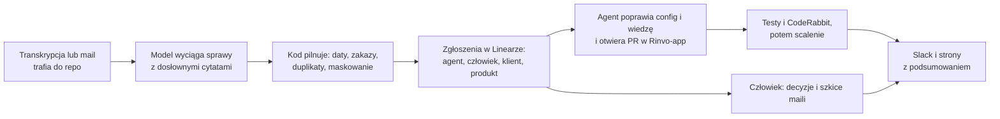

# Rinvo: od rozmowy z klientem do poprawki bez udziału człowieka

Transkrypcja rozmowy (albo mail) trafia do repozytorium, a system zamienia ją w sprawy w Linearze; agent sam poprawia konfigurację i bazę wiedzy w osobnym repo, a człowiek dostaje rano tylko to, co naprawdę wymaga decyzji.
Dane są fikcyjne, a całość to działający prototyp na GitHub Actions, Linearze i Slacku.

**Zobacz:** [strony klientów](https://rembolekk.github.io/Rinvo/index.html) · [głos klientów](https://rembolekk.github.io/Rinvo/glos-klientow.html) · [Rinvo-app z poprawkami agenta](https://github.com/Rembolekk/rinvo-app/pulls?q=is%3Apr+is%3Amerged)

## Jak to płynie

## Kto co robi

- **AI:** czyta rozmowy i maile, wyciąga z nich sprawy z cytatami, pisze szkice maili i poprawki konfiguracji.
- **Kod:** liczy daty, pilnuje zakazów klienta, uprawnień, limitów i bezpieczników wysyłki, rozdziela sprawy i scala poprawki.
- **Człowiek:** tylko to, czego nie wolno automatowi.
- **Wyjątki dla człowieka:** pieniądze i umowy, zakazy i decyzje zastrzeżone w karcie klienta, rzeczy nieodwracalne, szkice maili do wysłania, potwierdzenie karty nowego klienta, sprawy niepewne oraz pomysły produktowe raz w tygodniu.

## Wyniki próby od zera

- Dealer (Auto Tama): 12 z 12 kontroli przeszło; hotele (Hotele Bałtyk): 11 z 11.
- Od wpłynięcia rozmowy do wdrożonej poprawki: średnio 2 h 15 min (najkrócej 1 h 45 min), w całości bez udziału człowieka.
- Jedno zgłoszenie zamiast kilkudziesięciu: nowy klient daje człowiekowi jedno „Potwierdź kartę”, a jego sprawy czekają wstrzymane.
- Ponad 900 testów działających bez sieci i bez modelu, a w repo Rinvo-app z konfiguracją klientów jeszcze 15 testów konfiguracji i zakazów.

## Struktura repo

| Plik lub folder | Do czego |
|---|---|
| `ops/transkrypcje/`, `ops/maile/` | wejście: rozmowy i maile klientów |
| `przetworz.py`, `linear_sync.py` | analiza rozmowy i zakładanie zgłoszeń w Linearze |
| `ops/zasady.json` | reguły: kto co robi, limity, zakazy |
| `agent.py`, `agent_scal.py` | agent: zadanie → PR w Rinvo-app → scalenie |
| `szkice.py`, `wyslij.py` | szkice maili i wysyłka z bezpiecznikami |
| `podsumowanie.py`, `generuj_strony.py` | poranne podsumowanie na Slacku i strony |
| `ops/klienci/`, `wyniki/` | karty klientów (pamięć) i wyniki analiz |
| `.github/workflows/` | cała automatyzacja |
| `testy/`, `docs/` | testy oraz [szczegóły](docs/SZCZEGOLY.md) i [przypadki brzegowe](docs/PRZYPADKI-BRZEGOWE.md) |

## Jak uruchomić

1. **Sekrety** (GitHub: Settings → Secrets and variables → Actions): `CLAUDE_CODE_OAUTH_TOKEN`, `LINEAR_API_KEY`, `SLACK_WEBHOOK_URL`, `GMAIL_ADDRESS`, `GMAIL_APP_PASSWORD`, `AGENT_GITHUB_TOKEN`.
2. **Zmienne** (ta sama strona, zakładka Variables): `AGENT_WLACZONY=true` i `MAILE_WLACZONE=true`; w Settings → Pages włącz publikację z gałęzi `main`.
3. **Wrzuć transkrypcję:** plik `ops/transkrypcje/<klient>/RRRR-MM-DD-nazwa.md`, commit i push. Po kilkunastu minutach są: Slack, zgłoszenia w Linearze, PR w Rinvo-app i strony.

Szczegóły, moduły i testy: [docs/SZCZEGOLY.md](docs/SZCZEGOLY.md). Tabela przypadków brzegowych: [docs/PRZYPADKI-BRZEGOWE.md](docs/PRZYPADKI-BRZEGOWE.md).

## Ograniczenia i co dalej

- **Zastępczy wykonawca:** poprawki robi skrypt uruchamiany z GitHub Actions, który bierze zgłoszenia z Lineara; docelowo powinien to robić natywny agent Lineara.
- **Token zamiast konta bota:** agent działa na tokenach właściciela, więc komentarze są tylko podpisane „Agent:”; potrzebne jest osobne konto bota z własnymi uprawnieniami.
- **Cron zamiast zdarzeń:** maile i agent są sprawdzane co 15 minut, a nie reagują na zdarzenia, więc opóźnienie może sięgać kwadransa.
- **Dane fikcyjne:** firmy, osoby i adresy są zmyślone, a Rinvo-app to symulacja produktu.
- **Repo publiczne tylko dla demo:** w produkcji repo byłoby prywatne; już teraz maskujemy dane osób trzecich i nie publikujemy adresów e-mail na stronach.
